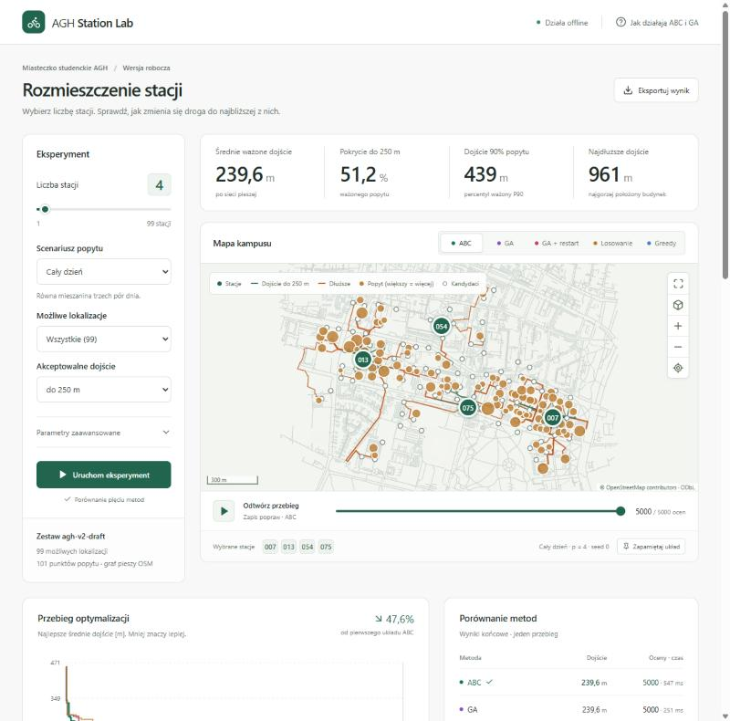

# Rozmieszczenie stacji na MS AGH

Projekt na przedmiot **Algorytmy inteligentne inspirowane naturą**, zespół 6 osób, semestr 2026/2027. Wybieramy `p` stacji rowerowych / punktów postoju hulajnóg, minimalizując średnie ważone dojście po grafie pieszym OpenStreetMap. Główna metoda: dyskretny **Artificial Bee Colony (ABC)**.

**Pierwszy pokaz: 9 listopada 2026. Gotowy projekt: 4 grudnia; rezerwa do około 15 grudnia.**

## Stan na 9 listopada

**Działa cały łańcuch na danych v2:** 101 punktów popytu, 99 kandydatów, ABC i metody odniesienia, dokładne optimum, aplikacja z trasami dojścia i budynkami 3D oraz komenda pełnych badań. Wyniki są wersją roboczą, bo żaden punkt nie przeszedł jeszcze audytu terenowego. Próba na docelowym laptopie wymaga potwierdzenia.

**[Jak to działa, co osiągnęliśmy i co zostało →](docs/STATUS.md)** · **[Szkic raportu →](docs/REPORT_DRAFT.md)**



## Od czego zacząć

| Dokument | Zawartość |
|---|---|
| [Stan projektu 08.11](docs/STATUS.md) | gotowe elementy, przebieg działania demo, wyniki pilota i rzeczywisty postęp względem planu |
| [Roadmapa](docs/ROADMAP.md) | etapy, proponowane role 6 osób, zależności i kryteria ukończenia |
| [Spotkanie 09.11](docs/MEETING_2026-11-09.md) | co pokazać, scenariusz prezentacji, pytania i plan awaryjny |
| [Research](docs/RESEARCH.md) | źródła naukowe i techniczne oraz decyzje dla projektu |
| [Dodatkowy research](docs/RESEARCH_EXTENSIONS.md) | dodatkowe propozycje, źródła lokalne i diagnostyka pilota |
| [Architektura](docs/ARCHITECTURE.md) | diagramy kontekstu, komponentów i przebiegu eksperymentu |
| [Model i dane](docs/DATA_MODEL.md) | funkcja celu, reprezentacja ABC, kontrakty i ograniczenia |
| [Eksperymenty](docs/EXPERIMENTS.md) | uczciwe porównanie metod, budżety, ziarna i metryki |
| [Backlog](docs/BACKLOG.md) | zadania gotowe do przeniesienia do Issues |
| [Praca z repo](CONTRIBUTING.md) | PR, CI, etykiety i wersjonowanie |

## Działający pilot

### Demo FastAPI + React na prezentację

Jednorazowe przygotowanie (wymaga internetu, Node.js 22+ i uv):

```sh
uv sync --locked --all-extras
npm --prefix frontend ci
npm --prefix frontend run build
```

Uruchomienie przygotowanego demo, również offline, z głównego katalogu repo:

```sh
uv run --locked --extra demo uvicorn agh_stations.api:app --host 127.0.0.1 --port 8001
```

Otwórz **http://127.0.0.1:8001**. Jeden serwer obsługuje API i zbudowany interfejs.
Demo pozwala zmieniać `p` (1–12), scenariusz, budżet i ziarno; porównuje ABC,
losowanie i greedy. Mapa MapLibre korzysta wyłącznie z lokalnej geometrii, bez kafelków,
CDN i kluczy API, pokazuje trasy dojścia i wielkość popytu, a przycisk z kostką włącza
budynki 3D (wymaga WebGL). Odtwarzanie pokazuje zapis rzeczywistych popraw najlepszego
układu po obliczeniach — nie transmisję roju na żywo. Eksport JSON zawiera parametry,
hash danych, wyniki i kroki. To pojedyncze przebiegi, nie seria 30 ziaren. Dokładne optimum
liczy solver MILP poza budżetem ocen. Domyślnie używane są dane `agh-v2`; zmienna
`AGH_DATASET=agh-pilot` przełącza na zestaw pilota.

Scenariusz pokazu: uruchom domyślne 4 stacje → odtwórz poprawy ABC → przełącz
metody → włącz widok 3D → zmień na 3 stacje i poranek → uruchom ponownie → omów
zmianę wyniku. Przed prezentacją zbuduj interfejs i przećwicz na laptopie docelowym.

Rozwój interfejsu: backend jak wyżej oraz w drugim terminalu `npm --prefix frontend run dev`.
Vite działa na http://127.0.0.1:5173 i przekazuje `/api` do portu 8001.
Dokumentacja API: http://127.0.0.1:8001/docs (jej zewnętrzne zasoby wymagają internetu).

### Pełne badania na danych v2

```sh
uv sync --locked --all-extras
uv run agh-stations study --output outputs/study
```

Protokół jest opisany w [EXPERIMENTS.md](docs/EXPERIMENTS.md), a zapis wersji roboczej znajduje się w [reports/v2-draft](reports/v2-draft). Przebudowa danych v2 wymaga wyciągu OSM (np. `malopolskie-latest.osm.pbf` z Geofabrik, poza repozytorium):

```sh
uv run --extra geo agh-stations prepare-v2 --pbf ścieżka/malopolskie-latest.osm.pbf
```

Bez `--pbf` generator korzysta z Overpass. Audyt terenowy opisuje [DATA_MODEL.md](docs/DATA_MODEL.md#audyt-terenowy).

### Eksperymenty CLI na pilocie

Repo zawiera też pierwszy snapshot: 18 zastępczych punktów popytu i 30 kandydatów. Zachowujemy go, żeby wyniki pilota dało się odtworzyć. Dane i założenia są opisane w [data/README.md](data/README.md).

**To demonstrator modelu:** wagi popytu są założone, a kandydaci wymagają weryfikacji w terenie.

Wymagania: [uv](https://docs.astral.sh/uv/getting-started/installation/) i Python 3.12 (uv może pobrać interpreter). Po instalacji zależności poniższe obliczenia działają offline:

```sh
uv sync --locked --all-extras
uv run agh-stations benchmark --p 4 --budget 1000 --runs 30 --exact
uv run agh-stations report
```

W `outputs/demo/` powstaną `runs.csv`, `history.csv`, `results.json`, `map.png/svg` i `convergence.png/svg`. Gotowy zapis pilota znajduje się w [reports/pilot](reports/pilot/README.md).

Ponowne pobranie OSM wymaga internetu; jest oddzielone od eksperymentów:

```sh
uv run --extra geo agh-stations prepare-osm
```

Kontrole przed PR:

```sh
uv run ruff check .
uv run ruff format --check .
uv run pytest
```

## Struktura

```text
configs/                  granica obszaru i założenia przygotowania danych
data/raw/                 lokalny cache, poza Git
data/processed/agh-pilot/  zamrożone dane do obliczeń offline
src/agh_stations/          model, solvery, przygotowanie OSM, CLI i wykresy
frontend/                 React/TypeScript, Leaflet i build interfejsu
tests/                    model, budżety, routing ze snapshotu i kontrakt API
docs/                     roadmapa, research, architektura i backlog
reports/pilot/            zapis wyników i ilustracje pierwszego modelu
reports/demo/             podgląd interfejsu prezentacyjnego
outputs/                  nowe wyniki lokalne, poza Git
.github/                  CI, szablony Issues/PR i definicje etykiet
```

Geometria i sieć: **© OpenStreetMap contributors**, [ODbL 1.0](https://opendatacommons.org/licenses/odbl/1-0/), [informacja OSM](https://www.openstreetmap.org/copyright). Licencja danych jest opisana oddzielnie od kodu; zespół powinien ustalić licencję kodu przed wydaniem końcowym.
