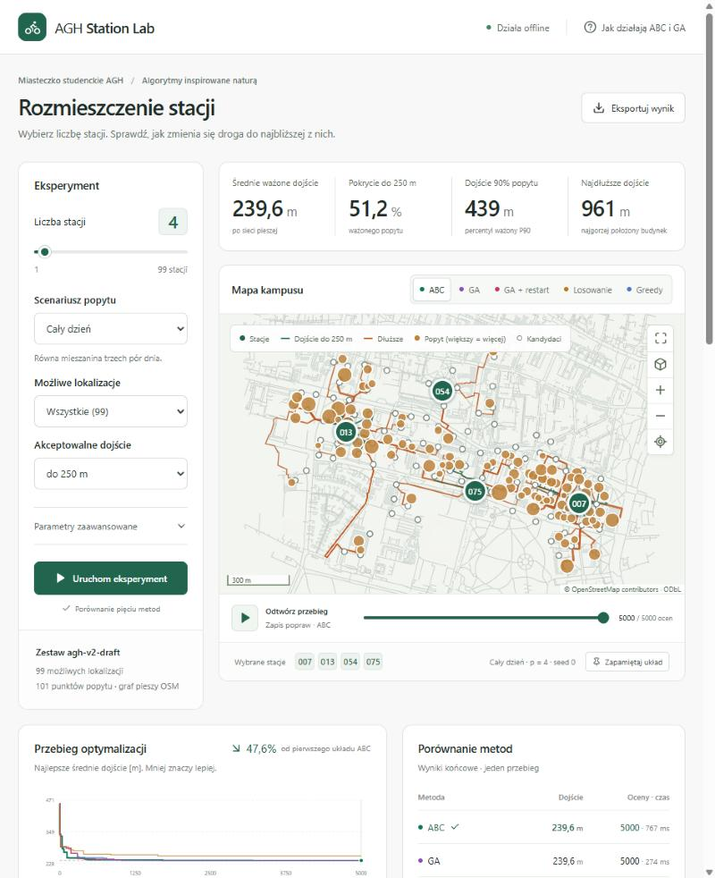
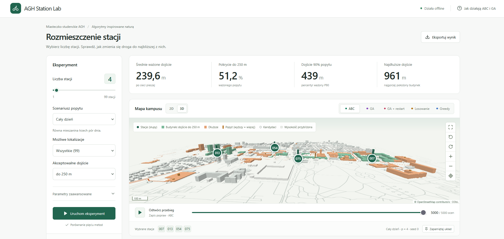

# Rozmieszczenie stacji rowerów i hulajnóg na Miasteczku Studenckim AGH

Projekt na przedmiot **Algorytmy inteligentne inspirowane naturą** (AGH, semestr zimowy 2026/2027, zespół 6 osób).

Szukamy miejsc na `p` stacji rowerów lub punktów postoju hulajnóg tak, aby średnie dojście piesze od budynków do najbliższej stacji było jak najkrótsze. Odległości liczymy po rzeczywistej sieci pieszej z OpenStreetMap, od wejść do budynków. Problem rozwiązujemy dwiema metodami inspirowanymi naturą, **sztuczną kolonią pszczół (ABC)** i **algorytmem genetycznym (GA)**, a wyniki porównujemy z metodami odniesienia i z dowiedzionym optimum.



**[Raport z projektu →](docs/REPORT.md)**

## Co zawiera projekt

- **Dane kampusu** z datowanego wyciągu OSM: 101 budynków generujących ruch (akademiki, budynki uczelni, biblioteka, hale, przychodnia), 99 możliwych lokalizacji stacji oraz macierz najkrótszych dojść pieszych.
- **Model p-median** z popytem dla poranka, dnia i wieczoru. Waga budynku to jego powierzchnia użytkowa razy założone natężenie ruchu dla funkcji budynku.
- **Pięć metod porównywanych z tym samym limitem ocen funkcji celu:** ABC, GA, GA z restartem populacji, losowanie oraz metoda zachłanna z zamianami. Optimum każdej instancji dowodzi solver programowania całkowitoliczbowego (MILP).
- **Pełny protokół badań w jednej komendzie:** strojenie na osobnej instancji rozwojowej, 30 przebiegów na metodę, testy statystyczne, krzywa wartości kolejnych stacji, rekomendacja etapowa i analizy wrażliwości.
- **Aplikacja webowa** (FastAPI + React + MapLibre), działająca w całości offline: mapa kampusu w 2D i 3D, trasy dojścia, odtwarzanie przebiegu optymalizacji i porównanie metod.

## Najważniejsze wyniki

Średnia strata do dowiedzionego optimum przy 10 000 ocen (30 przebiegów, wagi dla całego dnia):

| Metoda | 3 stacje | 5 stacji | 8 stacji |
|---|---:|---:|---:|
| ABC | 0,13% | 0,00% | 0,17% |
| GA | 0,00% | 0,00% | 0,31% |
| GA z restartem | 0,00% | 0,00% | 0,16% |
| Greedy + zamiany | 1,58% | 0,00% | 0,84% |
| Losowanie | 2,39% | 10,63% | 18,57% |

- ABC i obie wersje GA znajdują układy bardzo bliskie optimum i nie różnią się między sobą istotnie statystycznie. ABC jest istotnie lepsze od losowania.
- Nie wykazaliśmy ogólnej przewagi metod inspirowanych naturą nad prostymi metodami. Solver dokładny rozwiązuje to zadanie w około 0,15 s, więc wartość projektu leży w zbadaniu zachowania tych metod na realnym problemie.
- Restart populacji usuwa stagnację GA przy dłuższym liczeniu, a przy ciasnym budżecie bywa kosztem.
- **Rekomendacja:** 6 stacji w pierwszym etapie (184 m średniego dojścia, 75% popytu w zasięgu 250 m), a potem rozbudowa do 15 bez przenoszenia istniejących (109 m, 95%).

> **Założenie:** popyt jest założeniem modelu opartym na funkcji i wielkości budynków, a nie pomiarem ruchu studentów.

## Uruchomienie aplikacji

Wymagania: [uv](https://docs.astral.sh/uv/getting-started/installation/) (sam pobiera Pythona 3.12) i Node.js 22+. Przygotowanie, jednorazowo i z dostępem do internetu:

```sh
uv sync --locked --all-extras
npm --prefix frontend ci
npm --prefix frontend run build
```

Uruchomienie z głównego katalogu repozytorium, działa też bez internetu:

```sh
uv run --locked --extra demo uvicorn agh_stations.api:app --host 127.0.0.1 --port 8001
```

Aplikacja jest pod adresem **http://127.0.0.1:8001**. Pozwala:

- ustawić liczbę stacji (1–99), porę dnia, listę możliwych miejsc, akceptowalne dojście, budżet ocen i ziarno losowe,
- porównać na mapie wynik każdej metody oraz dokładne optimum,
- odtworzyć kolejne poprawy znalezione przez algorytm,
- obejrzeć trasy dojścia (w zasięgu i poza nim) i szczegóły po kliknięciu budynku lub stacji, na mapie płaskiej albo 3D,
- zobaczyć krzywą wartości kolejnych stacji, wyniki grup budynków, stratę w porach dnia, układ odporny, najdłuższe dojścia i obciążenie stacji,
- uruchomić serię 10–30 ziaren i porównać rozrzut wyników metod,
- zapamiętać układ i porównać go z kolejnym, a wynik wyeksportować do JSON.

### Mapa 3D

Przełącznik **2D | 3D** nad mapą zmienia widok. Domyślnie wyświetla się mapa płaska. Mapa 3D (MapLibre GL JS, bez zewnętrznych kafelków) pokazuje wynik w przestrzeni:

- budynki mają wysokość z OSM (`height` lub liczba kondygnacji); gdy jej brak, przyjmujemy 9 m i rysujemy je jaśniej,
- budynki generujące ruch są zielone, gdy dojście do najbliższej stacji mieści się w wybranym progu, a pomarańczowe, gdy jest dłuższe,
- wybrane stacje to zielone słupy z numerami, a wysokość brązowych słupków odpowiada wadze popytu budynku w wybranym scenariuszu,
- widok można obracać przyciskami albo przeciągając prawym przyciskiem myszy.

Wysokości służą tylko do wizualizacji. Odległości w modelu nadal są liczone po płaskim grafie pieszym.



Odtwarzanie pokazuje zapis rzeczywistych popraw po zakończeniu obliczeń, a nie transmisję roju na żywo. Dokumentacja API jest pod `/docs` (jej zasoby wymagają internetu). Przy pracy nad interfejsem można dodatkowo uruchomić `npm --prefix frontend run dev`: Vite działa na porcie 5173 i przekazuje `/api` do portu 8001.

## Badania

```sh
uv run agh-stations study --output outputs/study
```

Komenda działa offline i odtwarza wszystkie tabele i wykresy raportu: strojenie ABC i GA, porównanie metod z testami statystycznymi, większą liczbę stacji, krzywą stacji, rekomendację, pory dnia, próg dostępności, wagi, listy punktów i bramy. Wyniki użyte w raporcie są w [reports/results](reports/results), a protokół opisuje [raport](docs/REPORT.md).

Dwie analizy wymagają wyciągu OSM (np. `malopolskie-latest.osm.pbf` z Geofabrik, poza repozytorium): `scripts/verify_routes.py` sprawdza, że trasy nie przechodzą przez budynki, a `scripts/candidate_spacing.py` bada gęstość kandydatów. Z tego samego wyciągu można odtworzyć dane:

```sh
uv run --extra geo agh-stations prepare-v2 --pbf ścieżka/malopolskie-latest.osm.pbf
```

## Dane

| Katalog | Zawartość |
|---|---|
| `data/processed/agh-v2` | dane kampusu używane w aplikacji i badaniach, z manifestem i hashami plików |
| `data/processed/agh-development` | losowa instancja na tym samym grafie, wyłącznie do strojenia parametrów |
| `data/processed/agh-pilot` | pierwszy, mały zestaw (18 budynków, 30 miejsc); zostaje do testów i odtwarzania historii projektu |

Aplikację można przełączyć na inny zestaw zmienną `AGH_DATASET`, np. `AGH_DATASET=agh-pilot`.

## Dokumentacja

| Dokument | Zawartość |
|---|---|
| [Raport](docs/REPORT.md) | pełny opis problemu, danych, metod, wyników, rekomendacji, wniosków i literatury |
| [Dane](data/README.md) | zestawy danych i ich licencja |
| [Praca z repozytorium](CONTRIBUTING.md) | gałęzie, pull requesty i CI |

## Struktura repozytorium

```text
configs/            obszar kampusu, reguły popytu, kandydatów i tras
data/               zamrożone zestawy danych
src/agh_stations/   model, solvery, przygotowanie danych, badania, API i CLI
frontend/           interfejs React/TypeScript z mapą MapLibre
scripts/            analizy wymagające wyciągu OSM i narzędzia pomocnicze
tests/              testy modelu, solverów, danych, badań i API
reports/results/    wyniki badań użyte w raporcie
reports/app.jpg     zrzut aplikacji
reports/Mapa3D.png  zrzut mapy 3D
docs/REPORT.md      raport z projektu
```

## Kontrola jakości

```sh
uv run ruff check .
uv run ruff format --check .
uv run pytest
```

CI na GitHubie uruchamia lint, 148 testów, build interfejsu i skrócone badania przy każdym pull requeście.

## Licencja danych

Geometria i sieć: **© OpenStreetMap contributors**, [ODbL 1.0](https://opendatacommons.org/licenses/odbl/1-0/), [informacja OSM](https://www.openstreetmap.org/copyright). Licencja kodu nie została jeszcze ustalona.
