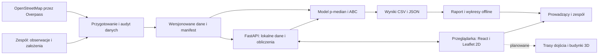
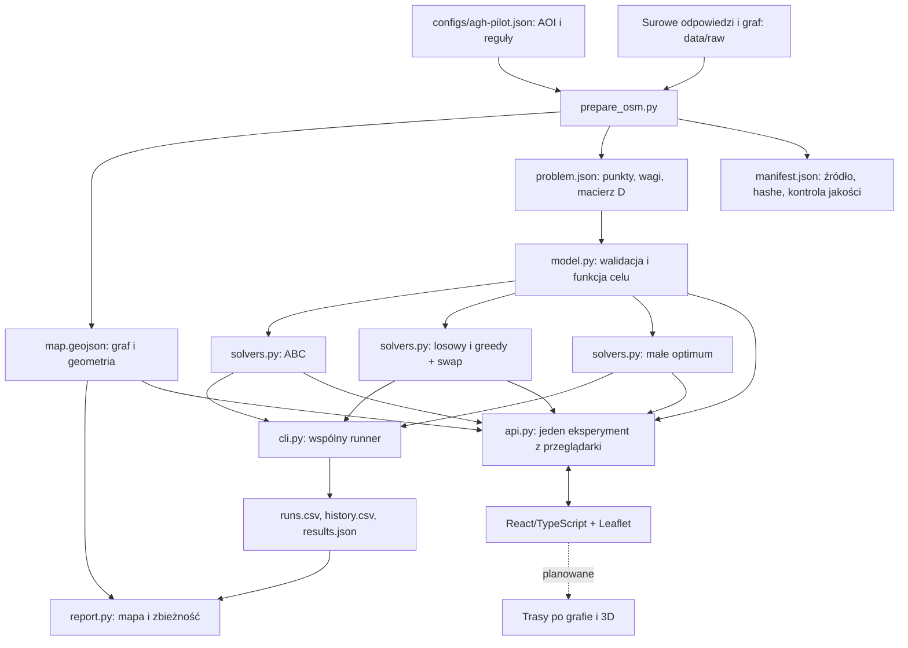
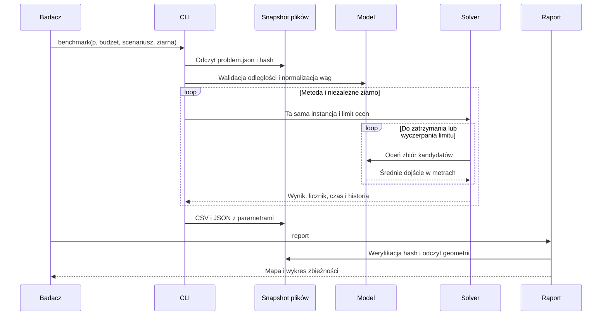

# Architektura rozwiązania

## Stan bieżący i docelowy

**Zaimplementowane w pilotażu:** przygotowanie OSM, wersjonowany kontrakt plików, model i trzy heurystyki, pełny przegląd, runner eksperymentów, wykresy/mapa statyczna, testy i CI.
**Demo prezentacyjne:** FastAPI (`api.py`) + React/TypeScript (`frontend/`), mapa Leaflet z lokalnej geometrii OSM, kontrolki parametrów, porównanie pojedynczych przebiegów, eksport JSON i odtwarzanie rzeczywistych popraw układu. Po buildzie frontend i API obsługuje jeden proces na porcie 8001. `GET /api/dataset`, `GET /api/map`, `GET /api/health` oraz synchroniczny `POST /api/run`; maksymalnie 20 000 ocen/metodę, jeden eksperyment naraz, pełny przegląd do 200 000 kombinacji. API weryfikuje hashe snapshotu. Nie pobiera OSM ani kafelków.

**Planowane do 4 grudnia:** audyt wejść i kandydatów, lokalne poprawki danych, scenariusze docelowe, trasy i budynki 3D; MapLibre pozostaje opcją dla warstwy 3D.

## Kontekst

## Komponenty i przepływ danych

Zewnętrzne zapytania występują tylko w przygotowaniu danych. Domyślny benchmark i raport działają offline. Macierz `D[n_popyt, n_kandydaci]` oddziela koszt routingu od optymalizacji; identyfikatory i kolejność są częścią kontraktu. Jeden evaluator liczy wszystkie wywołania celu, w tym inicjalizację, powtórzenia, częściowe układy greedy i zwiadowczynie.

## Przebieg odtwarzalnego eksperymentu

## Interfejs demonstracyjny i dalsze rozszerzenia

Bieżący interfejs React/TypeScript korzysta z synchronicznego FastAPI i Leaflet.
Przeglądarka wysyła parametry do `POST /api/run`, który uruchamia te same solvery co CLI.
Wynik zawiera metryki, finalne stacje i zapis kolejnych popraw z numerami ocen.
Odtwarzanie jest wizualizacją tego zapisu po zakończeniu obliczeń. Nie przedstawia całej
populacji pszczół ani transmisji obliczeń w czasie rzeczywistym.

Dane i geometria są lokalne, weryfikowane hashem. Po zbudowaniu interfejsu jeden proces
obsługuje frontend i API. Mapa pokazuje budynki, graf pieszy, popyt i kandydatów. Pozwala
przybliżać, przesuwać i oglądać wybrane stacje; nie rysuje jeszcze tras.

Do rysowania tras trzeba zachować sekwencje krawędzi lub wygenerować `routes.geojson`
dla wybranego rozwiązania. `map.geojson` zachowuje `u`, `v` i długości. Nie zastępujemy
najkrótszych dojść prostymi odcinkami. Budynki 3D i MapLibre pozostają osobnym etapem.

Ewentualne asynchroniczne `POST /runs` i `GET /runs/{id}` pozostają propozycją na
większe eksperymenty; małe prezentacyjne przebiegi obsługuje obecny endpoint synchroniczny.

## Decyzje i uzasadnienie

| Decyzja | Uzasadnienie | Kiedy wrócić do decyzji |
|---|---|---|
| Dyskretny wybór kandydatów | łatwo zachować `p` różnych punktów i kontrolować teren | jeśli prowadzący wymaga współrzędnych ciągłych |
| Długość dojścia, nie dystans w linii prostej | uwzględnienie topologii sieci w modelu | jeśli audyt ujawni niekompletność ścieżek |
| Pliki + manifest | mały zespół, łatwe eksperymenty i odtwarzanie | jeśli wyniki przekroczą wygodny rozmiar repo |
| Lokalny Python, bez GPU | obliczenia macierzowe i mały obszar | po pomiarze wąskiego gardła |
| 3D w warstwie prezentacji | wysokości nie wpływają na funkcję celu | przy dodaniu wysokości/schodów do kosztu ruchu |
| Lokalne synchroniczne API dla demo | ponowne użycie solverów CLI i jeden serwer na prezentację | przy większych eksperymentach wymagających zadań w tle |

## Kontrole jakości

Warstwa danych odpowiada za dostępność i pochodzenie, model za jednostki i wagi, solver za wykonalność i budżet, runner za niezależne ziarna i porównywalność. CI nie kontaktuje się z OSM. Test snapshotu ponownie liczy odległości z wyeksportowanych krawędzi. Pozostaje obowiązek audytu terenowego: testy matematyczne nie potwierdzają fizycznej dostępności wejścia ani miejsca na stację.
