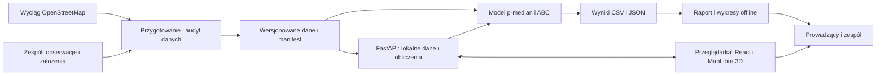
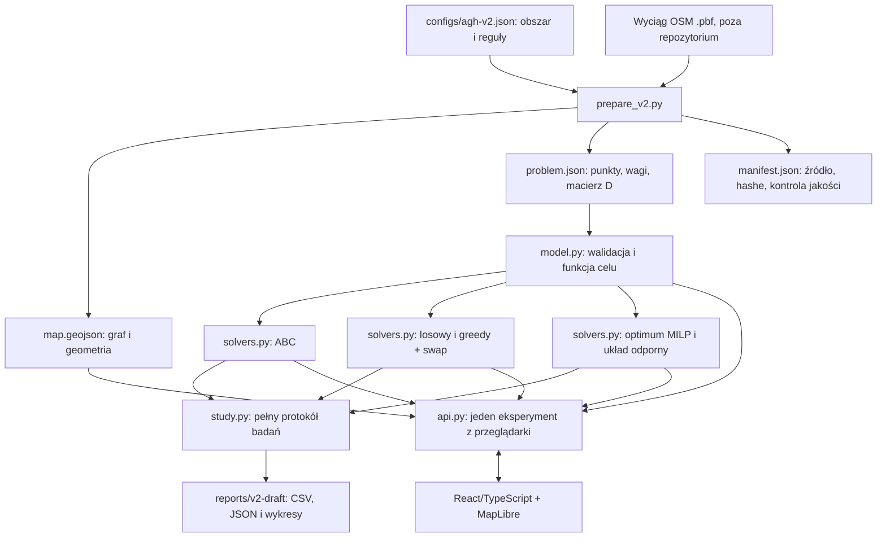
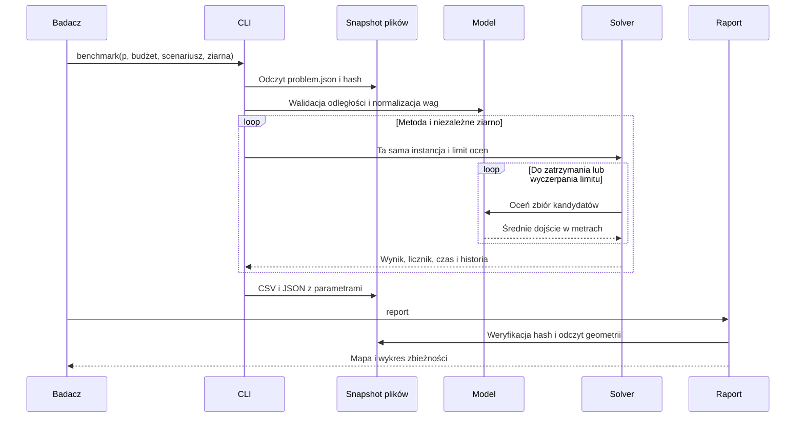

# Architektura rozwiązania

## Stan bieżący

**Dane i obliczenia:** generator v2 z datowanego wyciągu OSM, wersjonowany kontrakt plików, model p-median, ABC, algorytm genetyczny, losowanie, greedy z zamianami, lokalne przeszukiwanie z restartami, dokładne optimum (MILP), układ odporny, runner pełnego protokołu badań, wykresy i testy w CI.

**Aplikacja:** FastAPI (`api.py`) + React/TypeScript (`frontend/`) + MapLibre GL, wyłącznie z lokalnej geometrii OSM. Po buildzie frontend i API obsługuje jeden proces na porcie 8001. API weryfikuje hashe snapshotu i nie pobiera niczego z internetu.

| Endpoint | Rola |
|---|---|
| `GET /api/dataset`, `/api/map`, `/api/health` | punkty, listy kandydatów, minimalne budżety, geometria |
| `POST /api/run` | jeden eksperyment czterech metod z zapisem popraw; do 20 000 ocen na metodę |
| `POST /api/routes` | trasy po grafie od każdego budynku do najbliższej stacji |
| `POST /api/analysis` | grupy budynków, obciążenie stacji, strata w porach dnia, skutek zamkniętych bram |
| `POST /api/curve` | dowiedzione optima dla kolejnych liczb stacji |
| `POST /api/series` | wiele ziaren z tymi samymi ustawieniami |
| `POST /api/robust` | układ minimalizujący największą stratę między porami dnia |

## Kontekst

## Komponenty i przepływ danych

Zewnętrzne zapytania występują tylko w przygotowaniu danych. Domyślny benchmark i raport działają offline. Macierz `D[n_popyt, n_kandydaci]` oddziela koszt routingu od optymalizacji; identyfikatory i kolejność są częścią kontraktu. Jeden evaluator liczy wszystkie wywołania celu, w tym inicjalizację, powtórzenia, częściowe układy greedy i zwiadowczynie.

## Przebieg odtwarzalnego eksperymentu

## Interfejs demonstracyjny

Przeglądarka wysyła parametry do `POST /api/run`, który uruchamia te same solvery co badania. Wynik zawiera metryki, finalne stacje i zapis kolejnych popraw z numerami ocen. Odtwarzanie jest wizualizacją tego zapisu po zakończeniu obliczeń. Nie przedstawia całej populacji pszczół ani transmisji obliczeń w czasie rzeczywistym.

Trasy nie są rysowane jako odcinki proste: `Router` odtwarza z `map.geojson` ciąg krawędzi grafu, a skrypt `scripts/verify_routes.py` sprawdza je niezależnie względem obrysów budynków. Budynki 3D powstają przez wyciągnięcie obrysów; wysokość zastępcza jest oznaczona na mapie.

## Decyzje i uzasadnienie

| Decyzja | Uzasadnienie | Kiedy wrócić do decyzji |
|---|---|---|
| Dyskretny wybór kandydatów | łatwo zachować `p` różnych punktów i kontrolować teren | jeśli prowadzący wymaga współrzędnych ciągłych |
| Długość dojścia, nie dystans w linii prostej | uwzględnienie topologii sieci w modelu | jeśli audyt ujawni niekompletność ścieżek |
| Pliki + manifest | mały zespół, łatwe eksperymenty i odtwarzanie | jeśli wyniki przekroczą wygodny rozmiar repo |
| Lokalny Python, bez GPU | obliczenia macierzowe i mały obszar | po pomiarze wąskiego gardła |
| 3D w warstwie prezentacji | wysokości budynków nie wpływają na funkcję celu | przy dodaniu nachylenia lub schodów do kosztu ruchu |
| Lokalne synchroniczne API dla demo | ponowne użycie solverów CLI i jeden serwer na prezentację | przy większych eksperymentach wymagających zadań w tle |

## Kontrole jakości

Warstwa danych odpowiada za dostępność i pochodzenie, model za jednostki i wagi, solver za wykonalność i budżet, runner za niezależne ziarna i porównywalność. CI nie kontaktuje się z OSM. Test snapshotu ponownie liczy odległości z wyeksportowanych krawędzi. Pozostaje obowiązek audytu terenowego: testy matematyczne nie potwierdzają fizycznej dostępności wejścia ani miejsca na stację.
