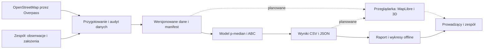
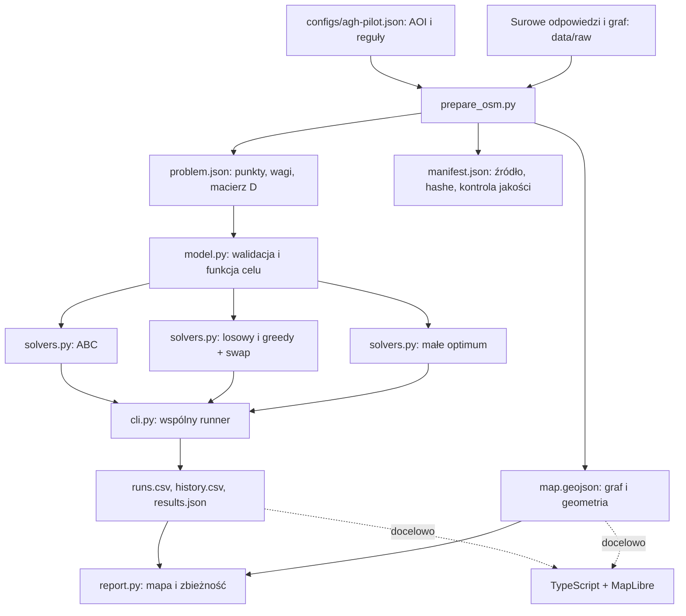
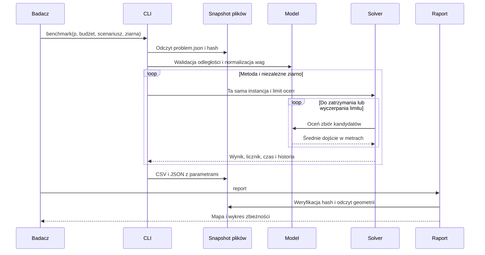

# Architektura rozwiązania

## Stan bieżący i docelowy

**Zaimplementowane w pilotażu:** przygotowanie OSM, wersjonowany kontrakt plików, model i trzy heurystyki, pełny przegląd, runner eksperymentów, wykresy/mapa statyczna, testy i CI.
**Planowane do 4 grudnia:** audyt wejść i kandydatów, lokalne poprawki danych, scenariusze docelowe, interfejs TypeScript/MapLibre z trasami i budynkami 3D. FastAPI pozostaje opcjonalne.

## Kontekst

## Komponenty i przepływ danych

Zewnętrzne zapytania występują tylko w przygotowaniu danych. Domyślny benchmark i raport działają offline. Macierz `D[n_popyt, n_kandydaci]` oddziela koszt routingu od optymalizacji; identyfikatory i kolejność są częścią kontraktu. Jeden evaluator liczy wszystkie wywołania celu, w tym inicjalizację, powtórzenia, częściowe układy greedy i zwiadowczynie.

## Przebieg odtwarzalnego eksperymentu

## Docelowy interfejs i ewentualne API

Pierwsza wersja interaktywna czyta `problem.json`, `map.geojson` i `results.json` z katalogu statycznego. Kontrolki wybierają już policzone `p`, scenariusz i metodę. Widok wyświetla kandydatów, popyt, wybrane stacje, rzeczywiste trasy po grafie, wynik w metrach, pokrycie i źródło danych. Zapisane wyniki ułatwiają powtórzenie demonstracji na laptopie.

Do rysowania tras trzeba zachować sekwencje krawędzi lub wygenerować `routes.geojson` dla wybranego rozwiązania. `map.geojson` pilota zachowuje `u`, `v` i długości, ale bieżący raport **jeszcze nie rysuje tras**. Nie wolno zastępować ich prostymi odcinkami opisanymi jako najkrótsze dojścia.

Jeśli po 20.11 potrzebna będzie optymalizacja z przeglądarki, proponowany kontrakt FastAPI to `POST /runs` (dataset ID, p, metoda, scenariusz, limit, seed), `GET /runs/{id}` (status, wynik) i `GET /datasets/{id}` (manifest). To projekt kontraktu, nie istniejące endpointy. Jeden proces obliczeniowy i pliki wystarczą na małą demonstrację. Każde żądanie musi mieć limit ocen i walidację parametrów. Nie uruchamiamy pobierania OSM w żądaniu użytkownika.

## Decyzje i uzasadnienie

| Decyzja | Uzasadnienie | Kiedy wrócić do decyzji |
|---|---|---|
| Dyskretny wybór kandydatów | łatwo zachować `p` różnych punktów i kontrolować teren | jeśli prowadzący wymaga współrzędnych ciągłych |
| Długość dojścia, nie dystans w linii prostej | uwzględnienie topologii sieci w modelu | jeśli audyt ujawni niekompletność ścieżek |
| Pliki + manifest | mały zespół, łatwe eksperymenty i odtwarzanie | jeśli wyniki przekroczą wygodny rozmiar repo |
| Lokalny Python, bez GPU | obliczenia macierzowe i mały obszar | po pomiarze wąskiego gardła |
| 3D w warstwie prezentacji | wysokości nie wpływają na funkcję celu | przy dodaniu wysokości/schodów do kosztu ruchu |
| Statyczny odczyt wyników przed API | niezależny rozwój mapy i badań | po ukończeniu podstawowego scenariusza interfejsu |

## Kontrole jakości

Warstwa danych odpowiada za dostępność i pochodzenie, model za jednostki i wagi, solver za wykonalność i budżet, runner za niezależne ziarna i porównywalność. CI nie kontaktuje się z OSM. Test snapshotu ponownie liczy odległości z wyeksportowanych krawędzi. Pozostaje obowiązek audytu terenowego: testy matematyczne nie potwierdzają fizycznej dostępności wejścia ani miejsca na stację.
