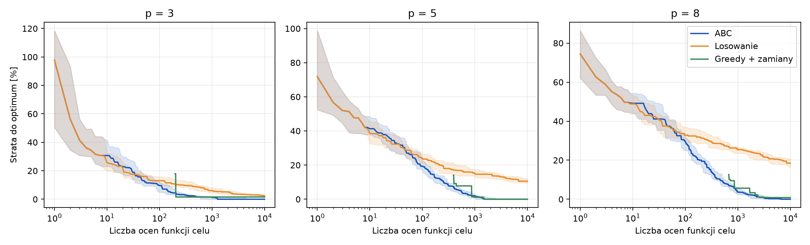
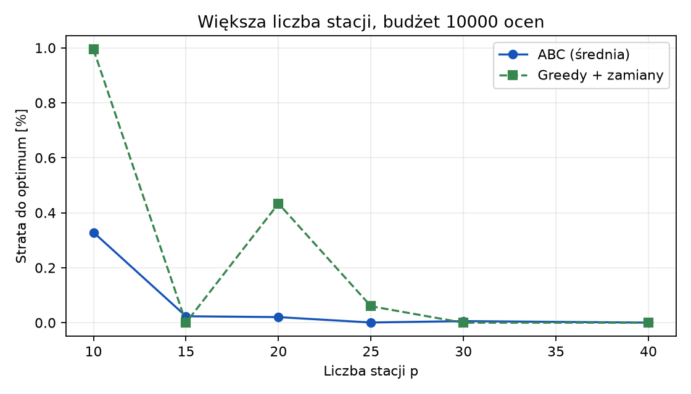
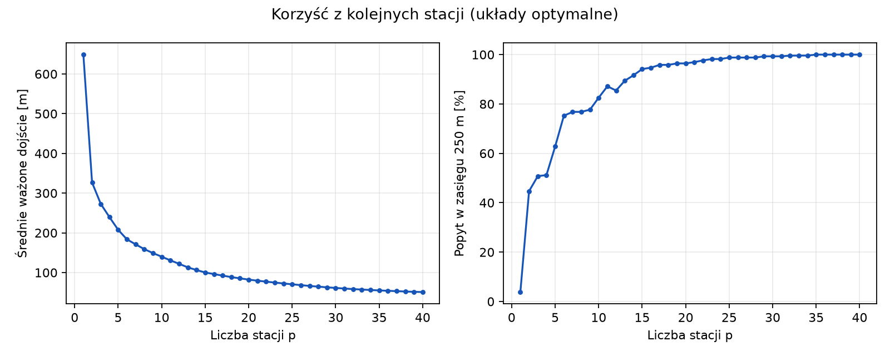
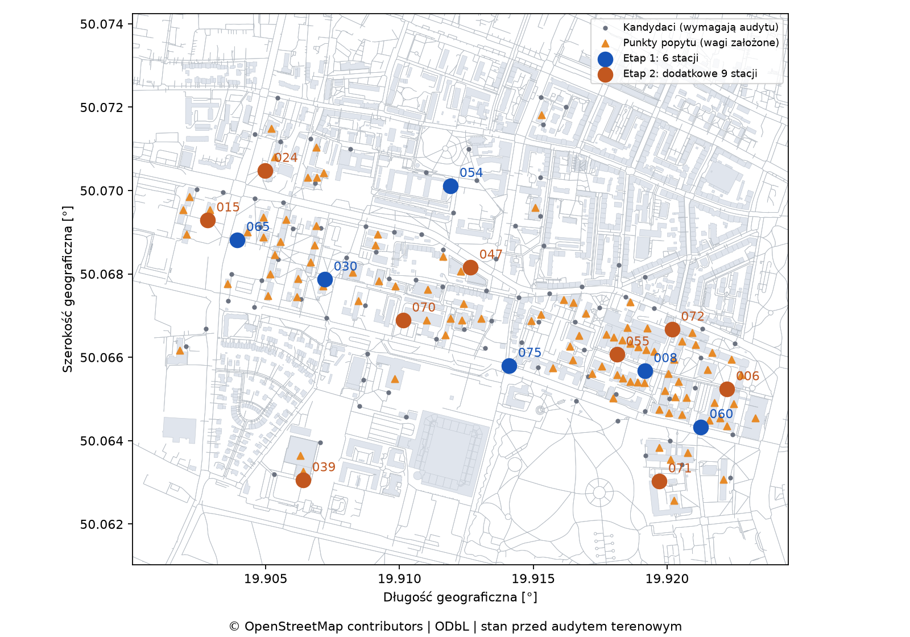
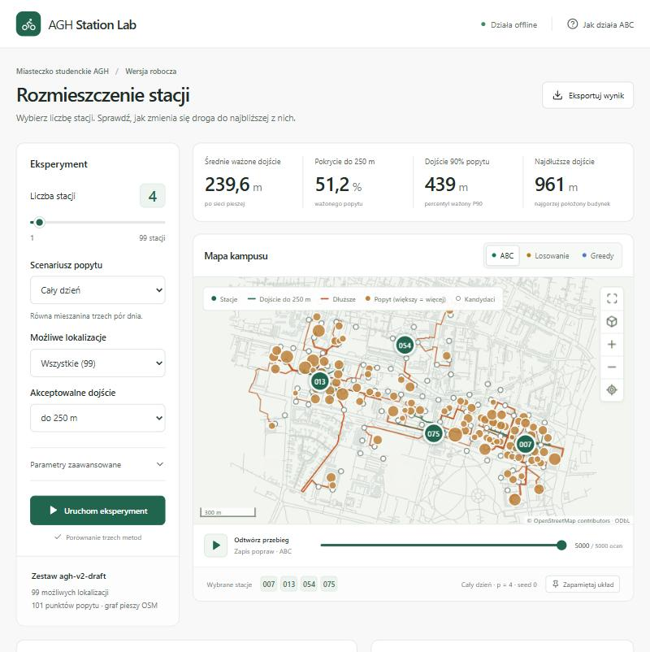

# Rozmieszczenie stacji rowerów i hulajnóg na Miasteczku Studenckim AGH

Raport z projektu · Algorytmy inteligentne inspirowane naturą · semestr zimowy 2026/2027

> **Założenie raportu.** Audyt terenowy nie został jeszcze wykonany: w arkuszu audytu wszystkie punkty mają status `requires_review`. Raport przyjmuje roboczo, że audyt potwierdzi wszystkie 99 lokalizacji kandydackich, 101 punktów popytu i przebieg dojść. Wnioski o konkretnych miejscach obowiązują tylko przy tym założeniu. Jeśli audyt coś zmieni, badania przelicza się jedną komendą (rozdział 12).

## 1. Streszczenie

Projekt wybiera `p` lokalizacji stacji rowerów lub punktów postoju hulajnóg na Miasteczku Studenckim AGH i w przyległej części kampusu, tak aby średnie ważone dojście piesze do najbliższej stacji było jak najkrótsze. Główną metodą jest dyskretna adaptacja sztucznej kolonii pszczół (ABC). Porównujemy ją z losowaniem, metodą zachłanną z zamianami, lokalnym przeszukiwaniem z restartami i dokładnym optimum z programowania całkowitoliczbowego.

Najważniejsze wyniki na instancji kampusowej (101 punktów popytu, 99 kandydatów):

- **Skuteczność ABC.** Przy 10 000 ocen ABC jest istotnie lepsze od losowania i trafia w dowiedzione optimum w 18–30 z 30 przebiegów dla `p ∈ {3, 5, 8}`.
- **ABC a proste metody.** Nie wykazaliśmy ogólnej przewagi ABC. Do `p = 8` nie różni się istotnie od lokalnego przeszukiwania z tym samym budżetem. Z greedy wygrywa tylko wtedy, gdy greedy utyka w optimum lokalnym albo kończy mu się budżet, a przy `p = 15` greedy jest od niego dokładniejsze. Większy zysk przy dużym `p` wynika w dużej mierze ze słabości wybranego wariantu lokalnego przeszukiwania.
- **Potrzeba metaheurystyki.** Solver dokładny rozwiązuje tę instancję w około 0,15 s, więc na tej skali ABC nie jest potrzebne praktycznie. Wartością projektu jest zbadanie jego zachowania na realnym problemie.
- **Rekomendacja.** Jeśli audyt potwierdzi dane: **6 stacji w pierwszym etapie** (184 m średnio, 75% popytu w zasięgu 250 m) i **rozbudowa do 15 stacji** (109 m, 95%). Dziewięć dodatkowych stacji uzupełnia etap 1 bez przenoszenia żadnej istniejącej.
- **Największa niepewność.** Wynik zależy przede wszystkim od tego, które budynki modelujemy i jaką mają powierzchnię, a nie od dokładnych wag kategorii.

## 2. Problem

Zadanie ma postać dyskretnego problemu p-median. Dla punktów popytu `I`, kandydatów `J` i odległości `d_ij` szukamy zbioru `S ⊆ J`, `|S| = p`, minimalizującego `Σ_i q_i · min_{j∈S} d_ij`, gdzie `q_i` to znormalizowana waga popytu. Docelowy układ jest stały w ciągu dnia, dlatego wagi to równa mieszanina trzech osobno znormalizowanych scenariuszy: rano, w dzień i wieczorem. Pełne definicje są w [DATA_MODEL.md](DATA_MODEL.md).

Oprócz funkcji celu raportujemy pokrycie, czyli udział ważonego popytu w zasięgu 250 m, ważony percentyl 90 i najdłuższe dojście. Próg 250 m jest parametrem badania, a nie normą.

Model zakłada dostępność pojazdu i miejsca zwrotu. Nie obejmuje pojemności stacji, bilansowania floty ani prognozy popytu.

## 3. Dane

Źródłem jest wyciąg OpenStreetMap dla Małopolski z Geofabrik, stan z 8.11.2026 (21:21 UTC). Sieć piesza ma 18 173 węzły i 39 516 skierowanych krawędzi, a obszar zawiera 1340 obrysów budynków. Z grafu usunięto 912 krawędzi biegnących przez wnętrza pełnych budynków (głównie schody i ścieżki w trybunach stadionu), 6 krawędzi wewnątrz budynków i 24 kołowroty. Mapowane przejścia, tunele i zadaszenia pozostały.

| Element | Wartość |
|---|---|
| Punkty popytu | 101: 22 akademiki, 71 budynków uczelnianych, 8 innych celów (biblioteka, hale sportowe, basen, przychodnia, klub, handel) |
| Dojście od budynku | 54 budynki mają wejścia z OSM; pozostałe używają punktu obrysu najbliższego grafowi |
| Łączniki | proste odcinki do grafu, najdłuższy 22 m; w 7 budynkach nie potwierdzono łącznika omijającego przeszkody |
| Kandydaci | 99: 47 parkingów rowerowych z OSM, 2 parkingi hulajnóg, 50 węzłów sieci do 150 m od popytu, co najmniej 70 m od siebie |

W pierwszym pilocie (18 punktów popytu, 30 kandydatów) nawet stacje we wszystkich miejscach dawały 183,4 m średniego dojścia i 81% pokrycia, więc wynik ograniczała lista kandydatów. Na obecnych danych wszystkie 99 miejsc daje 46,2 m i pełne pokrycie.

### Popyt

Wagi są założeniami, a nie pomiarami ruchu. Waga budynku to jego powierzchnia użytkowa (obrys × kondygnacje) pomnożona przez natężenie ruchu dla funkcji budynku i pory dnia:

| Kategoria | Natężenie na 1000 m²: rano | w dzień | wieczorem | Udział w popycie |
|---|---:|---:|---:|---:|
| Akademiki | 26 | 7 | 26 | 47,7% |
| Budynki uczelni | 9 | 15 | 3 | 45,9% |
| Inne cele | 7,5 | 15 | 22,5 | 6,4% |

Pierwsza wersja zakładała z góry sumę każdej kategorii. Osiem budynków kategorii „inne” ma 5,9% powierzchni, a dostawało 25% popytu, przez co pojedyncza hala ważyła tyle co kilka akademików. Teraz udział kategorii jest wynikiem, a dodanie budynku nie zabiera popytu innym. Natężenia zachowują wcześniejsze proporcje akademików do budynków uczelni oraz profil dobowy kategorii „inne”. Nowym założeniem jest tylko to, że metr kwadratowy budynku „inne” przyciąga w dzień tyle ruchu co metr budynku uczelni. Dla 31 budynków liczbę kondygnacji przyjęto jako medianę kategorii, a hala bez tej informacji ma jedną kondygnację.

## 4. Algorytm ABC

Źródło pożywienia to zbiór `p` różnych kandydatów. Ruch usuwa jeden element i dodaje inny, z prawdopodobieństwem 0,5 pochodzący z innego źródła. Pszczoły pracujące próbują poprawić każde źródło, obserwatorki wybierają źródła proporcjonalnie do `1/(1+F)`, a zwiadowczyni zastępuje najbardziej wyczerpane źródło po `limit` nieudanych próbach. Najlepszy układ jest przechowywany niezależnie od populacji. Jest to własna dyskretna adaptacja, bez zaokrąglania współrzędnych ciągłych.

Parametry dobrano na **osobnej instancji rozwojowej** (losowe punkty i wagi na tym samym grafie, 60 punktów popytu, 150 kandydatów, `p ∈ {5, 10, 20}`, 10 przebiegów), więc strojenie nie widziało danych końcowego porównania. Siatka objęła `foods ∈ {8, 12, 24}` i `limit ∈ {15, 30, 60, foods·p}`. Najmniejszą średnią stratę dało `foods = 8` i `limit = foods·p`.

| 8 źródeł, średnia strata do optimum | p = 5 | p = 10 | p = 20 |
|---|---:|---:|---:|
| `limit = 30` | 0,01% | 1,70% | 3,98% |
| `limit = foods·p` | 0,16% | 0,05% | 0,11% |

Stały limit działa dobrze tylko przy małym `p`. Limit rosnący z rozmiarem zadania odpowiada spotykanej w literaturze regule `limit = ne·D`, czyli liczba pszczół zatrudnionych razy wymiar zadania [5]. Ta sama praca podkreśla, że `limit` należy stroić dla konkretnego problemu, co potwierdza nasza siatka.

Wpływ mechanizmów ABC na instancji rozwojowej (średnia strata, 10 przebiegów):

| Wariant | p = 5 | p = 10 | p = 20 |
|---|---:|---:|---:|
| Wybrane ABC | 0,16% | 0,05% | 0,11% |
| Bez pobierania stacji z innego źródła | 1,84% | 5,73% | 2,67% |
| Obserwatorki z selekcją rangową | 0,01% | 0,10% | 0,45% |
| Bez fazy obserwatorek | 0,00% | 0,06% | 0,15% |
| Greedy + zamiany (jeden przebieg) | 0,00% | 0,11% | 1,26% |

Kluczowe jest pobieranie stacji z innych źródeł. Faza obserwatorek ma niewielki wpływ: funkcja `1/(1+F)` przy wartościach rzędu setek metrów prawie nie różnicuje źródeł.

## 5. Protokół badań

Wszystkie metody korzystają z tej samej macierzy odległości i tego samego limitu ocen funkcji celu. Punkt wyjścia to 10 000 ocen. ABC, losowanie i lokalne przeszukiwanie wykonują po 30 przebiegów (ziarna 0–29), a deterministyczne greedy jeden. Optimum każdej instancji dowodzi solver HiGHS.

Pytanie statystyczne ustalono przed obliczeniami: czy ABC daje mniejsze dojście niż losowanie (jednostronny test Manna-Whitneya, korekta Holma). Porównanie z lokalnym przeszukiwaniem dodano po obejrzeniu wyników, aby sprawdzić, czy przewaga nad greedy nie wynika tylko z wykorzystania większego budżetu. Jest to więc analiza eksploracyjna. Pełny opis jest w [EXPERIMENTS.md](EXPERIMENTS.md).

## 6. Kontrola poprawności

| Co sprawdzono | Wynik |
|---|---|
| Solver MILP a pełny przegląd | zgodne w testach automatycznych |
| Odtworzenie danych od wyciągu OSM | `problem.json` i `map.geojson` identyczne bajt w bajt |
| Odtworzenie pilota | ABC: średnia 343,837 m, 28/30 trafień, jak w pierwotnym zapisie |
| Długości tras a macierz odległości | 808 tras, 0 rozbieżności |
| Trasy a budynki | 17 305 krawędzi, 0 przez pełny budynek poza zmapowanym przejściem; 343 krawędzie w przejściach i tunelach |
| Rodzaj dróg na trasach | chodniki i ścieżki 79,1% długości, drogi serwisowe 18,8%, schody 0,8% |
| Wydłużenie trasy względem linii prostej | mediana 1,36, percentyl 90 równy 1,97, maksimum 4,40 |
| Testy automatyczne | 129 testów, lint, build frontendu, próbne badania w CI |

Trasy nie „latają” nad budynkami: model i mapa używają najkrótszych ścieżek po grafie pieszym. Wyjątkiem są krótkie proste łączniki od wejścia do grafu. W 3% użytych dojść nie potwierdzono, że łącznik omija budynki, a łączniki nie są sprawdzane względem ogrodzeń.

## 7. Porównanie metod

Średnia i najlepszy wynik w metrach, 10 000 ocen, 30 przebiegów:

| p | Optimum | ABC: najlepszy | ABC: średnia ± odch. | ABC: trafienia | Losowanie: najlepszy | Losowanie: średnia ± odch. | Strata losowania | Greedy | Oceny greedy |
|---:|---:|---:|---:|---:|---:|---:|---:|---:|---:|
| 3 | 272,95 | 272,95 | 273,29 ± 1,12 | 27/30 | 274,65 | 279,48 ± 2,33 | 2,39% | 277,25 | 582 |
| 5 | 207,66 | 207,66 | 207,66 ± 0,00 | 30/30 | 215,33 | 229,73 ± 5,25 | 10,63% | 207,66 | 2365 |
| 8 | 159,00 | 159,00 | 159,28 ± 0,42 | 18/30 | 178,38 | 188,53 ± 4,32 | 18,57% | 160,34 | 4404 |

ABC jest istotnie lepsze od losowania dla każdego `p` (skorygowane p < 10⁻¹¹). Wszystkie przebiegi ABC są co najmniej tak dobre jak greedy. Pojedynczy przebieg ABC i losowania trwa odpowiednio około 0,3 s i 0,13 s, greedy 4–41 ms, a solver dokładny około 0,15 s (jeden komputer, poza wspólnym budżetem).



**Porównanie z tym samym budżetem.** Greedy zatrzymuje się w pierwszym optimum lokalnym, zużywając tylko część ocen. Dlatego dodaliśmy metodę, która wydaje cały budżet: losowy start, zamiany typu najlepsza poprawa i restart.

| p | ABC: strata | ABC: trafienia | Lokalne przeszukiwanie: strata | Trafienia | Test dwustronny, p |
|---:|---:|---:|---:|---:|---:|
| 3 | 0,126% | 27/30 | 0,000% | 30/30 | 0,081 |
| 5 | 0,000% | 30/30 | 0,068% | 29/30 | 0,334 |
| 8 | 0,172% | 18/30 | 0,852% | 17/30 | 0,159 |
| 10 | 0,329% | 9/30 | 0,792% | 5/30 | 0,0002 |
| 15 | 0,023% | 28/30 | 14,451% | 0/30 | < 10⁻¹¹ |
| 20 | 0,020% | 29/30 | 25,052% | 0/30 | < 10⁻¹¹ |

Do `p = 8` różnice nie są istotne. Przy `p = 10` ABC jest lepsze, ale jest to wynik analizy dodanej po obejrzeniu danych. Straty 14–25% przy `p = 15` i `20` nie świadczą o sile ABC. Wariant z najlepszą poprawą sprawdza całe sąsiedztwo przed każdym ruchem, co kosztuje tam 1260–1580 ocen, więc w budżecie 10 000 ocen mieści się tylko 6–8 kroków z losowego startu. Silniejszy rywal, np. przyjmujący pierwszą znalezioną poprawę, mógłby ten wynik zmienić.

**Większa liczba stacji** (strata do optimum; 30 przebiegów przy 10 000 ocen, 10 przy 30 000):

| p | ABC, 10 000 | Trafienia ABC | Greedy, 10 000 | Oceny greedy | ABC, 30 000 | Greedy, 30 000 |
|---:|---:|---:|---:|---:|---:|---:|
| 10 | 0,329% | 9/30 | 0,994% | 4505 | 0,015% | 0,994% |
| 15 | 0,023% | 28/30 | 0,000% | 8940 | 0,000% | 0,000% |
| 20 | 0,020% | 29/30 | 0,434% (koniec budżetu) | 10 000 | 0,000% | 0,000% |
| 25 | 0,001% | 28/30 | 0,060% (koniec budżetu) | 10 000 | 0,000% | 0,000% |
| 30 | 0,006% | 29/30 | 0,000% (koniec budżetu) | 10 000 | 0,000% | 0,000% |
| 40 | 0,000% | 28/30 | 0,000% | 7900 | 0,000% | 0,000% |

ABC wygrywa z greedy w dwóch sytuacjach: gdy greedy utyka w optimum lokalnym (`p = 3, 8, 10`) i gdy kończy mu się budżet (`p = 20, 25`). W pozostałych przypadkach greedy znajduje optimum, a ABC traci najwyżej 0,03%. Przy 30 000 ocen dla `p ≥ 15` obie metody są równe, więc przewaga przy `p = 20` i `25` wynika wyłącznie z ciasnego budżetu. Losowanie traci 20–52%. Wynik zależy też od danych: przy poprzedniej regule wag greedy trafiało w optimum dla `p = 3` i `8`.



## 8. Ile stacji i gdzie

Korzyść z kolejnych stacji wyraźnie maleje. Przejście z 1 na 2 stacje skraca średnie dojście o 322 m, z 4 na 5 o 32 m, a z 10 na 11 o 9 m. Celem jest odległość, a nie pokrycie, więc pokrycie nie musi rosnąć z każdą stacją: dla `p = 11` wynosi 87,2%, a dla `p = 12` spada do 85,5%.

| p | 1 | 2 | 3 | 4 | 5 | 6 | 8 | 10 | 12 | 15 | 20 | 30 | 40 |
|---|---:|---:|---:|---:|---:|---:|---:|---:|---:|---:|---:|---:|---:|
| Średnie dojście [m] | 649 | 327 | 273 | 240 | 208 | 184 | 159 | 140 | 122 | 100 | 82 | 61 | 51 |
| Pokrycie 250 m | 3,8% | 44,7% | 50,8% | 51,2% | 62,8% | 75,2% | 76,8% | 82,5% | 85,5% | 94,1% | 96,4% | 99,3% | 100% |



### Rekomendacja

Reguły ustalono na krzywej, a nie na konkretnych miejscach. Etap 1 to najmniejsza liczba stacji pokrywająca 75% popytu w zasięgu 250 m. Etap 2 kończy się na ostatniej stacji, która skraca średnie dojście o co najmniej 5 m. Etap 2 rozbudowuje etap 1 bez przenoszenia stacji, a solver dowodzi najlepszego wyboru dodatkowych miejsc.

| Układ | Stacje | Średnie dojście | Pokrycie 250 m | P90 | Najdłuższe |
|---|---:|---:|---:|---:|---:|
| Etap 1 | 6 | 183,7 m | 75,2% | 335 m | 856 m |
| Etap 2 (rozbudowa etapu 1) | 15 | 109,3 m | 94,9% | 204 m | 605 m |
| Optimum 15 stacji bez etapów | 15 | 100,2 m | 94,1% | 215 m | 605 m |

Zachowanie etapu 1 kosztuje 9,0% średniego dojścia względem układu 15 stacji projektowanego od zera, ale nie obniża pokrycia.



| Etap | Stacja | Szerokość, długość | Pochodzenie | Największy obsługiwany budynek | Budynki | Popyt po obu etapach |
|---:|---|---|---|---|---:|---:|
| 1 | 065 | 50,06882; 19,90394 | węzeł sieci | Olimp | 9 | 13,5% |
| 1 | 030 | 50,06787; 19,90721 | parking rowerowy | DS Kapitol | 11 | 11,8% |
| 1 | 008 | 50,06567; 19,91916 | parking rowerowy | DS Nawojka | 14 | 8,0% |
| 1 | 075 | 50,06580; 19,91410 | węzeł sieci | DS Alfa | 5 | 7,2% |
| 1 | 054 | 50,07011; 19,91191 | węzeł sieci | akademik bez nazwy w OSM | 2 | 6,6% |
| 1 | 060 | 50,06433; 19,92125 | węzeł sieci | Budynek Jubileuszowy | 9 | 6,0% |
| 2 | 055 | 50,06607; 19,91813 | węzeł sieci | budynek uczelni bez nazwy w OSM | 14 | 8,8% |
| 2 | 015 | 50,06929; 19,90282 | parking rowerowy | DS Akropol | 5 | 7,6% |
| 2 | 006 | 50,06524; 19,92224 | parking rowerowy | Gmach Główny AGH | 6 | 7,2% |
| 2 | 072 | 50,06667; 19,92019 | węzeł sieci | budynek uczelni bez nazwy w OSM | 6 | 5,6% |
| 2 | 024 | 50,07048; 19,90498 | parking rowerowy | DS Piast | 6 | 5,4% |
| 2 | 070 | 50,06688; 19,91013 | węzeł sieci | budynek uczelni bez nazwy w OSM | 6 | 4,3% |
| 2 | 071 | 50,06303; 19,91971 | węzeł sieci | Instytut Filologii Wschodniosłowiańskiej UJ | 2 | 3,7% |
| 2 | 047 | 50,06815; 19,91265 | parking rowerowy | Centrum Informatyki AGH | 4 | 2,7% |
| 2 | 039 | 50,06305; 19,90640 | parking rowerowy | hala sportowa bez nazwy w OSM | 2 | 1,6% |

Priorytety audytu wyznacza [candidates_to_check.csv](../reports/v2-draft/candidates_to_check.csv), które porządkuje 49 kandydatów według częstości występowania w układach optymalnych.

## 9. Wrażliwość

**Pora dnia.** Stały układ zoptymalizowany dla całego dnia traci względem układu dobranego osobno dla danej pory:

| p | Rano | W dzień | Wieczorem |
|---:|---:|---:|---:|
| 3 | 0,03% | 12,28% | 1,46% |
| 5 | 0,26% | 6,01% | 11,55% |
| 8 | 3,49% | 11,89% | 4,20% |

Układ odporny minimalizuje największą z tych strat, czyli wyrównuje ją między porami dnia:

| p | Najgorsza strata układu całodziennego | Najgorsza strata układu odpornego | Koszt na całym dniu |
|---:|---:|---:|---:|
| 3 | 12,28% | 10,42% | 3,16% |
| 5 | 11,55% | 10,07% | 1,20% |
| 8 | 11,89% | 9,57% | 1,44% |
| 10 | 18,38% | 12,61% | 0,52% |
| 15 | 10,42% | 8,05% | 1,03% |

Założona równa mieszanina pór dnia ma mały wpływ: policzenie jednej pory podwójnie kosztuje układ bazowy najwyżej 1,03%.

**Próg dostępności** (pokrycie tego samego układu):

| p | 150 m | 250 m | 350 m |
|---:|---:|---:|---:|
| 3 | 29,0% | 50,8% | 68,6% |
| 5 | 39,9% | 62,8% | 88,0% |
| 8 | 51,1% | 76,8% | 93,9% |

**Założone wagi** (strata układu bazowego wobec optimum przy zmienionych wagach, `p ∈ {3, 5, 8}`):

| Zmiana | Strata |
|---|---:|
| Natężenie jednej kategorii ±25% | do 0,47% |
| Podwojenie jednej pory dnia w mieszaninie | do 1,03% |
| Równy podział popytu w kategorii | 1,0–4,5% |
| Bez kondygnacji, tylko obrys budynku | 5,0–13,7% |
| Jednakowe wagi wszystkich budynków | 6,9–8,4% |
| Poprzednia reguła stałych udziałów kategorii | 2,9–10,9% |

**Liczba kandydatów.** Średnie optimum [m] z 20 losowych krótszych list:

| p | 14 kandydatów | 24 | 49 | 74 | 99 (pełna lista) |
|---:|---:|---:|---:|---:|---:|
| 3 | 313,8 | 298,4 | 281,0 | 277,1 | 272,9 |
| 5 | 258,5 | 234,0 | 221,9 | 212,8 | 207,7 |
| 8 | 226,8 | 199,1 | 171,4 | 164,2 | 159,0 |

Ograniczenie do istniejących parkingów (49 miejsc) kosztuje 2,4–6,9%. Układ wyznaczony na krótszej liście oceniamy zawsze na pełnej liście popytu.

**Gęstość kandydatów.** Listę przebudowano z innymi odstępami (optimum w metrach):

| Odstęp | Kandydaci | p = 3 | p = 5 | p = 8 | p = 15 |
|---|---:|---:|---:|---:|---:|
| 35 m | 272 | 265,9 | 204,3 | 154,3 | 97,1 |
| 50 m | 168 | 271,3 | 207,7 | 155,4 | 101,1 |
| **70 m (przyjęty)** | **99** | **273,0** | **207,7** | **159,0** | **100,2** |
| 100 m | 61 | 276,0 | 213,7 | 166,4 | 111,2 |
| 140 m | 34 | 276,6 | 219,3 | 175,7 | 126,1 |

Zagęszczenie do 35 m poprawia optimum tylko o 1,6–3,1%, a wymaga sprawdzenia 2,7 razy więcej miejsc. Odstęp 70 m jest rozsądnym kompromisem.

**Lista budynków.** Wybór połowy budynków daje stratę 3,0–15,2%, a użycie wyłącznie budynków z wejściami w OSM 6,0–34,9%. Pominięcie kategorii „inne” kosztuje 0–2,6%. **Które budynki i jak duże modelujemy, to założenie o największym wpływie na wynik.**

**Długie dojścia i grupy budynków** (`p = 5`):

| Grupa | Budynki | Średnio | P90 | Maks. | Pokrycie 250 m |
|---|---:|---:|---:|---:|---:|
| Cały kampus | 101 | 208 m | 368 m | 856 m | 62,8% |
| Akademiki | 22 | 144 m | 329 m | 335 m | 75,5% |
| Budynki uczelni | 71 | 241 m | 417 m | 709 m | 53,0% |
| Inne cele | 8 | 443 m | 855 m | 856 m | 38,4% |

**Bramy.** W grafie zostało 597 bram, których stanu OSM nie opisuje. Gdyby wszystkie były zamknięte jednocześnie, 10,8% ważonego popytu (14 budynków) straciłoby drogę do najbliższej wybranej stacji, a dla pozostałych średnia wzrosłaby o 3,5–5,8%. To skrajny scenariusz, ale wskazuje bramy do sprawdzenia w terenie.

## 10. Aplikacja

Aplikacja FastAPI + React + MapLibre działa w całości offline i korzysta z tych samych solverów co badania. Pozwala wybrać liczbę stacji od 1 do liczby kandydatów, scenariusz, listę kandydatów, próg zasięgu, budżet i ziarno. Pokazuje:

- mapę z budynkami 3D, popytem i trasami po sieci pieszej, z wyróżnieniem dojść poza zasięgiem,
- odtwarzanie zapisu popraw oraz porównanie ABC, losowania, greedy i optimum,
- krzywą wartości kolejnych stacji, wyniki grup budynków, stratę w porach dnia, układ odporny, najdłuższe dojścia i obciążenie stacji,
- serię 10–30 ziaren, szczegóły po kliknięciu budynku lub stacji i porównanie dwóch układów.



Odtwarzanie pokazuje rzeczywiste poprawy po zakończeniu obliczeń, a nie transmisję roju na żywo.

## 11. Wnioski

1. **Dyskretne ABC działa na realnym problemie.** Przy 10 000 ocen znajduje układy bardzo bliskie dowiedzionemu optimum i jest istotnie lepsze od losowania.
2. **Nie wykazaliśmy ogólnej przewagi ABC nad prostymi metodami.** Do `p = 8` lokalne przeszukiwanie jest równie dobre. ABC bywa lepsze od greedy, gdy greedy utyka lub ma za mały budżet, ale przy `p = 15` to greedy jest dokładniejsze. Wyniki przy dużym `p` wobec lokalnego przeszukiwania zależą od jego słabego wariantu, a cała ocena dotyczy jednej instancji z założonym popytem.
3. **Na tej skali solver dokładny jest najlepszym narzędziem.** Dowodzi optimum w około 0,15 s. ABC miałoby przewagę praktyczną dopiero przy znacznie większych instancjach lub funkcji celu, której nie da się zapisać liniowo.
4. **O jakości ABC decydują limit porzucenia i pobieranie stacji z innych źródeł.** Faza obserwatorek ma tu niewielki wpływ.
5. **Rozsądny układ to 6 stacji, a potem rozbudowa do 15.** Dalsze stacje skracają dojście o mniej niż 5 m każda.
6. **Jeden układ na cały dzień kosztuje do około 18% w najgorszej porze** (przy 10 stacjach). Układ odporny zmniejsza tę stratę niewielkim kosztem średniej.
7. **Największym ryzykiem jest model popytu.** Weryfikacja listy budynków i liczby kondygnacji da więcej niż dalsze strojenie algorytmu.

## 12. Ograniczenia i odtworzenie

**Ograniczenia:**

- Wnioski o miejscach zakładają pozytywny audyt, który nie został wykonany. OSM może nie odzwierciedlać ogrodzeń, bram i własności terenu.
- Wagi nie pochodzą z pomiarów ruchu, a natężenia na metr kwadratowy są założeniem zespołu.
- Model nie ma pojemności stacji: jedna stacja może przejąć dowolną część popytu.
- Obszar jest prostokątem przyjętym przez zespół; akademiki na zachodzie MS leżą blisko jego granicy.
- Łączniki od wejść do grafu są odcinkami prostymi.
- Stan 597 bram jest nieznany; w głównym modelu są otwarte.
- Istniejący stojak rowerowy w OSM to tylko wiarygodne miejsce, a nie stacja pojazdów współdzielonych.
- Porównanie obejmuje jedną metodę rojową. Algorytm świetlików był opcjonalnym rozszerzeniem i nie został wykonany.

**Odtworzenie:**

```sh
uv sync --locked --all-extras
uv run agh-stations study --output outputs/study
```

Dane są zamrożone w repozytorium, a ich hashe zapisuje manifest. Wyniki tego raportu są w [reports/v2-draft](../reports/v2-draft). Tabele wymagające wyciągu OSM odtwarzają `scripts/candidate_spacing.py` i `scripts/verify_routes.py`. Po audycie: wpisać decyzje do arkusza, uruchomić `uv run agh-stations apply-audit --strict`, przeliczyć badania na powstałym katalogu i zaktualizować liczby. Procedura jest opisana w [DATA_MODEL.md](DATA_MODEL.md#audyt-terenowy).

## 13. Wkład członków zespołu

**[DO UZUPEŁNIENIA przez zespół: imiona i nazwiska oraz zakres prac 6 osób.]**

## 14. Literatura

1. Karaboga, D., Basturk, B. (2007). A powerful and efficient algorithm for numerical function optimization: artificial bee colony (ABC) algorithm. *Journal of Global Optimization*, 39, 459–471.
2. García-Palomares, J. C., Gutiérrez, J., Latorre, M. (2012). Optimizing the location of stations in bike-sharing programs: A GIS approach. *Applied Geography*, 35(1–2), 235–246.
3. Cintrano, C., Chicano, F., Alba, E. (2024). Using metaheuristics for the location of bicycle stations. Preprint, arXiv:2402.03945.
4. Basti, M., Sevkli, M. (2015). An artificial bee colony algorithm for the p-median facility location problem. *International Journal of Metaheuristics*, 4(1).
5. Veček, N., Liu, S.-H., Črepinšek, M., Mernik, M. (2017). On the Importance of the Artificial Bee Colony Control Parameter ‘Limit’. *Information Technology and Control*, 46(4). DOI 10.5755/j01.itc.46.4.18215.
6. Dane: © OpenStreetMap contributors, licencja ODbL 1.0.
