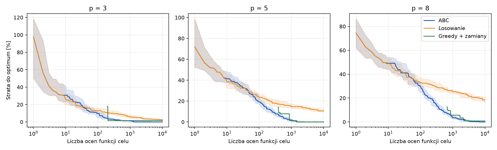
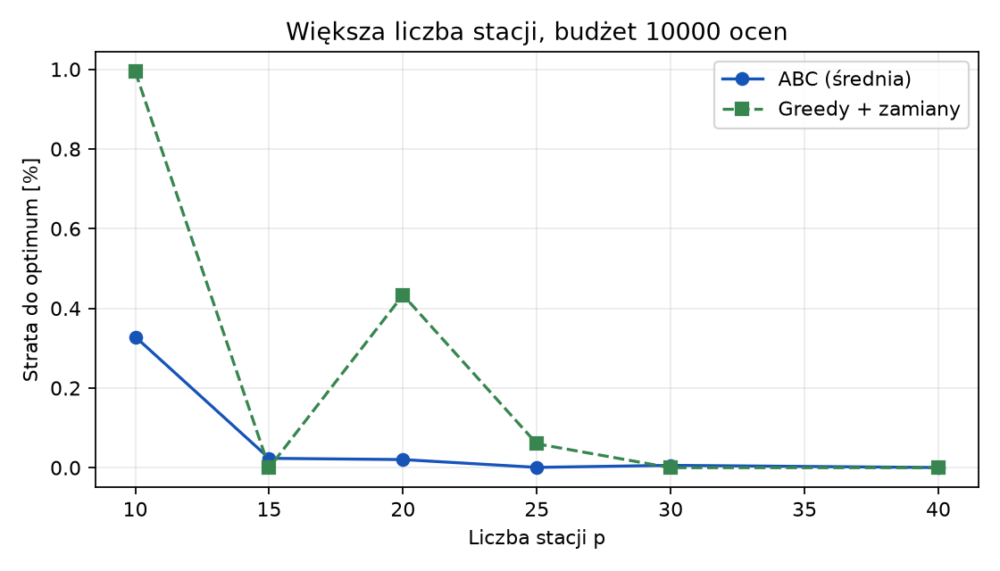
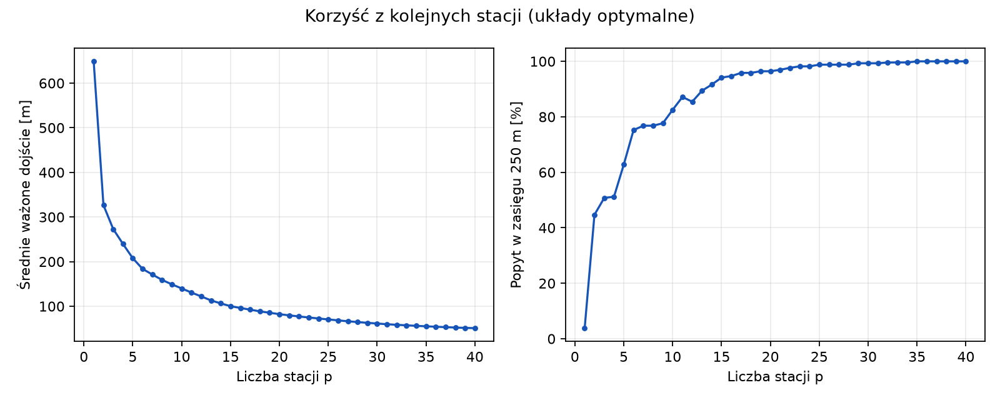
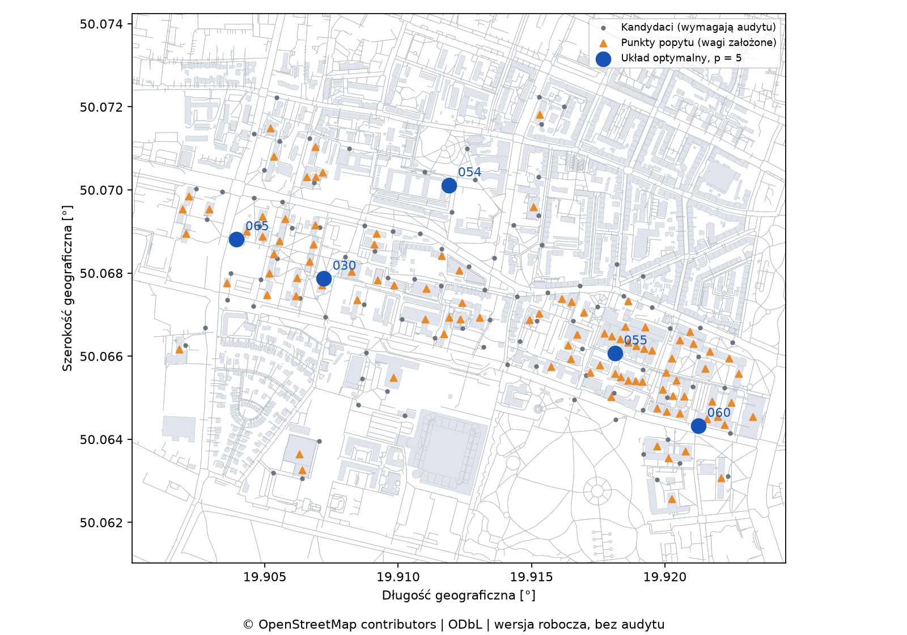

# Rozmieszczenie stacji rowerów i hulajnóg na MS AGH — szkic raportu

> **Wersja robocza z 09.11.2026.** Żaden z 99 kandydatów nie został jeszcze sprawdzony w terenie, więc wyniki opisują model, a nie gotową rekomendację lokalizacji. Po audycie trzeba przeliczyć badania jedną komendą (rozdział 8) i zaktualizować liczby. Miejsca do uzupełnienia przez zespół oznaczono **[DO UZUPEŁNIENIA]**.

## 1. Streszczenie

Wybieramy `p` lokalizacji stacji rowerów lub punktów postoju hulajnóg na Miasteczku Studenckim AGH i w przyległej części kampusu, minimalizując średnie ważone dojście po rzeczywistej sieci pieszej OpenStreetMap. Główną metodą jest dyskretna adaptacja algorytmu sztucznej kolonii pszczół (ABC), porównana z wyszukiwaniem losowym, metodą zachłanną z lokalnymi zamianami oraz dokładnym optimum wyznaczonym programowaniem całkowitoliczbowym.

Na instancji kampusowej (101 punktów popytu, 99 kandydatów, budżet 10 000 ocen) ABC było istotnie lepsze od losowania i trafiało w optimum w 18–30 z 30 przebiegów. Dla `p = 3` i `8` ABC było też lepsze od metody zachłannej (średnia strata 0,13% i 0,17% wobec 1,58% i 0,84%), a dla `p = 5` obie metody znalazły optimum. **Tej przewagi nie należy uogólniać:** greedy kończy pracę w pierwszym optimum lokalnym, a przy poprzedniej regule wag trafiało w optimum lub traciło 0,01%. Solver dokładny rozwiązuje tę instancję w ułamku sekundy, więc wartość projektu leży w zbadaniu zachowania metody rojowej, a nie w konieczności jej użycia.

## 2. Problem

Zadanie ma postać dyskretnego problemu p-median. Dla punktów popytu `I`, kandydatów `J` i odległości `d_ij` szukamy zbioru `S ⊆ J`, `|S| = p`, minimalizującego `Σ_i q_i · min_{j∈S} d_ij`, gdzie `q_i` to znormalizowana waga popytu. Docelowy układ jest stały w ciągu dnia, dlatego wagi to równa mieszanina trzech osobno znormalizowanych scenariuszy (rano, w dzień, wieczorem). Pełne definicje są w [DATA_MODEL.md](DATA_MODEL.md). Dodatkowo raportujemy pokrycie, czyli udział ważonego popytu w zasięgu 250 m.

Model zakłada dostępność pojazdu i miejsca zwrotu. Nie obejmuje pojemności stacji, bilansowania floty ani prognozy popytu.

## 3. Dane

Źródłem jest wyciąg OpenStreetMap dla Małopolski z Geofabrik, stan z 8.11.2026 (21:21 UTC). Sieć piesza ma 18 173 węzły i 39 516 skierowanych krawędzi, a obszar zawiera 1340 obrysów budynków. Z grafu usunięto 912 krawędzi biegnących przez wnętrza pełnych budynków (głównie schody i ścieżki w trybunach stadionu), 6 krawędzi wewnątrz budynków i 24 kołowroty; mapowane przejścia, tunele i zadaszenia pozostały.

| Element | Wartość |
|---|---|
| Punkty popytu | 101: 22 akademiki, 71 budynków uczelnianych, 8 innych celów (biblioteka, hale sportowe, przychodnia, klub, handel) |
| Dojście od budynku | 54 budynki mają wejścia z OSM; pozostałe używają punktu obrysu najbliższego grafowi |
| Łączniki | proste odcinki do grafu, najdłuższy 22 m; w 7 budynkach nie potwierdzono łącznika omijającego przeszkody |
| Kandydaci | 99: 47 parkingów rowerowych z OSM, 2 parkingi hulajnóg, 50 węzłów sieci do 150 m od popytu, co najmniej 70 m od siebie |
| Audyt terenowy | **0 z 99 kandydatów sprawdzonych** |

W stosunku do pierwszego pilota (18 punktów popytu, 30 kandydatów) lista miejsc przestała ograniczać wynik. Gdyby postawić stacje we wszystkich kandydatach, średnie dojście wyniosłoby 46,2 m przy pełnym pokryciu 250 m, wobec 183,4 m i 81% w pilocie.

Wagi są założeniami, nie pomiarami ruchu. Waga budynku to jego powierzchnia użytkowa (obrys × kondygnacje) pomnożona przez założone natężenie ruchu dla funkcji budynku i pory dnia. Udział kategorii wynika więc z tego, ile takich budynków jest na kampusie: akademiki 47,7%, budynki uczelni 45,9%, pozostałe cele 6,4% popytu.

Pierwsza wersja zakładała z góry sumę każdej kategorii. Osiem budynków kategorii `other` ma 5,9% powierzchni, a dostawało 25% popytu, przez co pojedyncza hala miała wagę kilku akademików. Natężenia dobrano tak, by zachować wcześniejsze proporcje akademików do budynków uczelni i profil dobowy kategorii `other` (1:2:3), a metr kwadratowy budynku `other` w ciągu dnia przyciągał tyle ruchu co metr budynku uczelni. Dla 31 budynków liczbę kondygnacji przyjęto jako medianę kategorii. Hala sportowa bez tej informacji ma jedną kondygnację, bo jest jednym wysokim pomieszczeniem.

## 4. Algorytm ABC

Źródło pożywienia to zbiór `p` różnych kandydatów. Ruch usuwa jeden element i dodaje inny, z prawdopodobieństwem 0,5 pochodzący z innego źródła. Pszczoły pracujące próbują poprawić każde źródło, obserwatorki wybierają źródła proporcjonalnie do `1/(1+F)`, a zwiadowczyni zastępuje źródło porzucone po `limit` nieudanych próbach. Najlepszy układ jest przechowywany niezależnie od populacji.

Parametry dobrano na **osobnej instancji rozwojowej** (losowe punkty na tym samym grafie, 60 punktów popytu, 150 kandydatów, `p ∈ {5, 10, 20}`, 10 przebiegów), więc strojenie nie widziało danych końcowego porównania. Siatka objęła `foods ∈ {8, 12, 24}` i `limit ∈ {15, 30, 60, foods·p}`. Wybrano `foods = 8`, `limit = foods·p`.

Najważniejszym parametrem okazał się limit porzucenia. Dla 8 źródeł strata do optimum przy `limit = 30` wynosiła 2,17% (`p = 10`) i 3,97% (`p = 20`), a przy `limit = foods·p` odpowiednio 0,02% i 0,34%. Regułę `limit = SN·D` spotyka się w literaturze o ABC **[DO UZUPEŁNIENIA: źródło]**.

Wpływ mechanizmów ABC na instancji rozwojowej (średnia strata do optimum, 10 przebiegów):

| Wariant | p = 5 | p = 10 | p = 20 |
|---|---:|---:|---:|
| Wybrane ABC | 0,00% | 0,02% | 0,34% |
| Bez inspiracji innym źródłem | 1,47% | 3,15% | 3,84% |
| Obserwatorki rangowe | 0,26% | 0,06% | 0,53% |
| Bez fazy obserwatorek | 0,09% | 0,20% | 0,33% |
| Greedy + zamiany (jeden przebieg) | 0,00% | 0,00% | 0,11% |

Kluczowe jest pobieranie stacji z innych źródeł. Faza obserwatorek ma niewielki wpływ: funkcja `1/(1+F)` przy wartościach rzędu setek metrów prawie nie różnicuje źródeł, a zamiana na selekcję rangową nie poprawiła wyniku.

## 5. Protokół eksperymentów

Wszystkie metody korzystają z tej samej macierzy odległości i limitu 10 000 ocen funkcji celu. ABC i losowanie wykonują po 30 przebiegów (ziarna 0–29), a deterministyczne greedy jeden. Optimum każdej instancji dowodzi solver HiGHS, zweryfikowany testami z pełnym przeglądem. Pytanie statystyczne ustalono przed obliczeniami: czy ABC daje mniejsze dojście niż losowanie (jednostronny test Manna-Whitneya, korekta Holma). Szczegóły są w [EXPERIMENTS.md](EXPERIMENTS.md).

## 6. Wyniki

| p | Optimum [m] | ABC: średnia [m] | ABC: trafienia | Losowanie: średnia [m] | Losowanie: strata | Greedy [m] | Greedy: oceny |
|---:|---:|---:|---:|---:|---:|---:|---:|
| 3 | 272,95 | 273,29 | 27/30 | 279,48 | 2,39% | 277,25 | 582 |
| 5 | 207,66 | 207,66 | 30/30 | 229,73 | 10,63% | 207,66 | 2365 |
| 8 | 159,00 | 159,28 | 18/30 | 188,53 | 18,57% | 160,34 | 4404 |

ABC jest istotnie lepsze od losowania dla każdego `p` (skorygowane p < 10⁻¹¹). Wszystkie przebiegi ABC są co najmniej tak dobre jak greedy. Greedy zatrzymuje się jednak w pierwszym optimum lokalnym, zużywając 582–4404 z 10 000 ocen, więc ABC ma tu do dyspozycji znacznie więcej obliczeń. Na trudniejszej instancji rozwojowej greedy było co najmniej tak dobre jak ABC.



**Większa liczba stacji.** Sprawdzamy, czy ABC zyskuje przy większym `p`, gdzie greedy potrzebuje więcej ocen (strata do optimum; ABC i losowanie po 30 przebiegów przy 10 000 ocen oraz po 10 przy 30 000).

| p | ABC, 10 000 ocen | Trafienia ABC | Greedy, 10 000 ocen | Oceny greedy | ABC, 30 000 ocen | Greedy, 30 000 ocen |
|---:|---:|---:|---:|---:|---:|---:|
| 10 | 0,329% | 9/30 | 0,994% | 4505 | 0,015% | 0,994% |
| 15 | 0,023% | 28/30 | 0,000% | 8940 | 0,000% | 0,000% |
| 20 | 0,020% | 29/30 | 0,434% (koniec budżetu) | 10 000 | 0,000% | 0,000% |
| 25 | 0,001% | 28/30 | 0,060% (koniec budżetu) | 10 000 | 0,000% | 0,000% |
| 30 | 0,006% | 29/30 | 0,000% (koniec budżetu) | 10 000 | 0,000% | 0,000% |
| 40 | 0,000% | 28/30 | 0,000% | 7900 | 0,000% | 0,000% |

ABC wygrywa w dwóch sytuacjach: gdy greedy utyka w optimum lokalnym (`p = 3, 8, 10`) i gdy kończy mu się budżet (`p = 20, 25`). W pozostałych przypadkach greedy znajduje optimum, a ABC traci najwyżej 0,03%. Losowanie traci 20–52%.



Korzyść z kolejnych stacji wyraźnie maleje. Przejście z 1 na 2 stacje skraca średnie dojście o 322 m, z 4 na 5 o 32 m, a z 10 na 11 o 9 m. Celem optymalizacji jest odległość, a nie pokrycie, dlatego pokrycie nie musi rosnąć z każdą stacją: dla `p = 11` wynosi 87,2%, a dla `p = 12` spada do 85,5%.

| p | 1 | 2 | 3 | 4 | 5 | 6 | 8 | 10 | 12 | 15 | 20 | 30 | 40 |
|---|---:|---:|---:|---:|---:|---:|---:|---:|---:|---:|---:|---:|---:|
| Średnie dojście [m] | 649 | 327 | 273 | 240 | 208 | 184 | 159 | 140 | 122 | 100 | 82 | 61 | 51 |
| Pokrycie 250 m | 3,8% | 44,7% | 50,8% | 51,2% | 62,8% | 75,2% | 76,8% | 82,5% | 85,5% | 94,1% | 96,4% | 99,3% | 100% |





### Wrażliwość

**Pora dnia.** Stały układ zoptymalizowany dla całego dnia traci względem układu dobranego osobno dla danej pory:

| p | Rano | W dzień | Wieczorem |
|---:|---:|---:|---:|
| 3 | 0,03% | 12,28% | 1,46% |
| 5 | 0,26% | 6,01% | 11,55% |
| 8 | 3,49% | 11,89% | 4,20% |

Układ odporny minimalizuje największą z tych strat. Solver dowodzi jego optymalności w kilka sekund, a koszt na całym dniu jest niewielki:

| p | Najgorsza strata układu całodziennego | Najgorsza strata układu odpornego | Koszt na całym dniu |
|---:|---:|---:|---:|
| 3 | 12,28% | 10,42% | 3,16% |
| 5 | 11,55% | 10,07% | 1,20% |
| 8 | 11,89% | 9,57% | 1,44% |
| 10 | 18,38% | 12,61% | 0,52% |
| 15 | 10,42% | 8,05% | 1,03% |

Założona równa mieszanina pór dnia ma mały wpływ: policzenie jednej pory podwójnie kosztuje układ bazowy najwyżej 1,03%.

**Próg dostępności** (pokrycie tego samego układu):

| p | 150 m | 250 m | 350 m |
|---:|---:|---:|---:|
| 3 | 29,0% | 50,8% | 68,6% |
| 5 | 39,9% | 62,8% | 88,0% |
| 8 | 51,1% | 76,8% | 93,9% |

**Założone wagi.** Zmiana natężenia jednej kategorii o ±25% prawie nie zmienia wyniku: strata układu bazowego wynosi co najwyżej 0,47%. Silniej działa sposób rozdziału popytu między budynki. Równy podział w kategorii daje stratę 1,0–4,5%, wagi jednakowe dla wszystkich budynków 6,9–8,4%, a pominięcie liczby kondygnacji 5,0–13,7%. Powrót do poprzedniej reguły stałych udziałów kategorii kosztowałby 2,9–10,9%. Stacje 039 i 051 z układu dla 5 stacji, które przy poprzedniej regule stały przy halach sportowych, nie wchodzą już do tego układu.

**Dobór punktów.** Układ wyznaczony na krótszej liście oceniamy zawsze na pełnej liście popytu. Trzy czwarte kandydatów kosztuje 1,6–2,8%, połowa 2,8–4,3%, ćwierć 8,8–24,1%, a ograniczenie do istniejących parkingów 2,4–6,9%. Po przebudowaniu listy kandydatów z innym odstępem (`candidate_spacing.csv`) zagęszczenie z 70 m do 35 m (272 kandydatów) poprawia optimum o 1,6–3,1%, a rozrzedzenie do 100 m pogarsza je o 1,1–11,0%. Odstęp 70 m uznajemy więc za rozsądny kompromis między jakością a liczbą miejsc do sprawdzenia w terenie.

Lista popytu działa silniej: wybór połowy budynków daje stratę 3,0–15,2%, a użycie wyłącznie budynków z wejściami w OSM 6,0–34,9%. Pominięcie kategorii `other` kosztuje teraz 0–2,6%, a przy poprzedniej regule 7,3–41,7%. **Które budynki i jak duże modelujemy, to nadal założenie o największym wpływie na wynik i powinno zostać zweryfikowane**, np. danymi o liczbie miejsc w akademikach.

**Długie dojścia i grupy budynków.** Średnia ukrywa nierówności. Dla `p = 5` ważony percentyl 90 wynosi 368 m, a maksimum 856 m. Budynki uczelniane są obsługiwane gorzej (średnio 241 m, pokrycie 53,0%) niż akademiki (144 m, 75,5%). Mało ważone cele z kategorii `other` mają średnio 443 m i pokrycie 38,4%, co jest bezpośrednim skutkiem niskiej wagi tych budynków. Szczegóły są w `groups.csv`.

**Bramy.** W grafie zostało 597 bram, których stanu OSM nie opisuje. Gdyby wszystkie były zamknięte jednocześnie, 10,8% ważonego popytu (14 budynków) straciłoby drogę do najbliższej wybranej stacji, a dla pozostałych średnia wzrosłaby o 3,5–5,8%. To skrajny scenariusz, ale pokazuje, które bramy trzeba sprawdzić w terenie.

## 7. Ograniczenia

- Żadna lokalizacja nie została sprawdzona w terenie, a dane OSM mogą nie odzwierciedlać ogrodzeń, bram i własności terenu.
- Wagi nie pochodzą z pomiarów ruchu, a natężenia na metr kwadratowy są założeniem zespołu.
- Model nie ma pojemności stacji: jedna stacja może przejąć dowolną część popytu.
- Obszar jest roboczym prostokątem. Akademiki w zachodniej części MS leżą blisko jego granicy, więc granicę trzeba zatwierdzić.
- Łączniki od wejść do grafu są odcinkami prostymi, a w 7 budynkach przebieg łącznika pozostaje niepotwierdzony.
- Stan 597 bram jest nieznany; w głównym modelu są otwarte.
- Istniejący stojak rowerowy w OSM to tylko wiarygodne miejsce, a nie stacja pojazdów współdzielonych.
- Parametry ABC dobrano na instancji rozwojowej z tym samym grafem, ale innymi punktami i wagami. Wnioski o ABC dotyczą tego problemu i tej skali.
- Porównanie obejmuje jedną metodę rojową. Algorytm świetlików pozostaje opcjonalnym rozszerzeniem, którego nie wykonano.

## 8. Odtworzenie

```sh
uv sync --locked --all-extras
uv run agh-stations study --output outputs/study
```

Dane są zamrożone w repozytorium, a ich hashe zapisuje manifest. Procedura audytu terenowego jest opisana w [DATA_MODEL.md](DATA_MODEL.md#audyt-terenowy). Priorytety sprawdzania wyznacza [candidates_to_check.csv](../reports/v2-draft/candidates_to_check.csv): pierwsze 10 pozycji z 49 pojawia się w układach optymalnych najczęściej.

## 9. Wkład członków zespołu

**[DO UZUPEŁNIENIA przez zespół.]**

## 10. Literatura

1. Karaboga, D., Basturk, B. (2007). A powerful and efficient algorithm for numerical function optimization: artificial bee colony (ABC) algorithm. *Journal of Global Optimization*, 39, 459–471.
2. García-Palomares, J. C., Gutiérrez, J., Latorre, M. (2012). Optimizing the location of stations in bike-sharing programs: A GIS approach. *Applied Geography*, 35(1–2), 235–246.
3. Cintrano, C., Chicano, F., Alba, E. (2024). Using metaheuristics for the location of bicycle stations. Preprint, arXiv:2402.03945.
4. Dane: © OpenStreetMap contributors, licencja ODbL 1.0.
