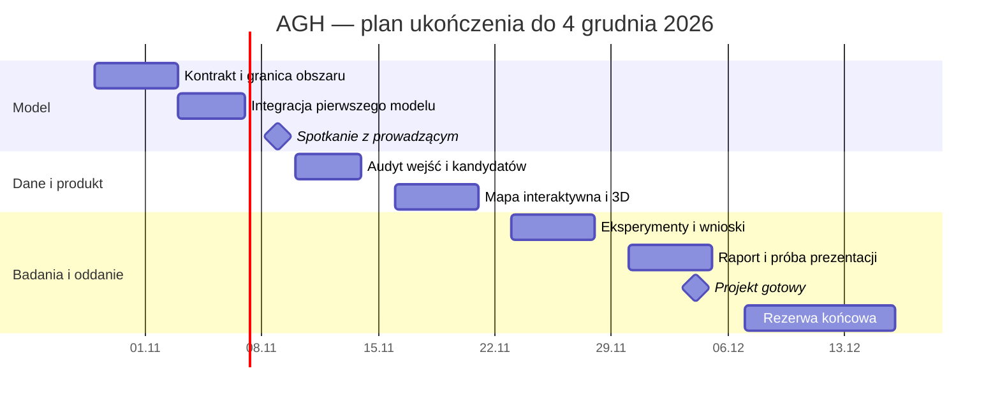

# Roadmapa: od pilotażu do gotowego projektu

Stan planu: **29.10.2026**. Pierwsze spotkanie: **poniedziałek 09.11.2026**.
Cel zespołu: zakończyć projekt **04.12.2026**; **15.12.2026 to granica rezerwy**, a nie planowany termin implementacji.

## Decyzja o zakresie

Budujemy demonstrator rozmieszczenia stacji rowerowych / punktów postoju hulajnóg na MS AGH i przyległej części kampusu. Wybieramy dokładnie `p` miejsc ze skończonej listy kandydatów. Minimalizujemy średnie ważone dojście po sieci pieszej. Podstawową metodą jest dyskretny ABC. Porównania: losowanie, zachłanne dodawanie i lokalne zamiany, pełny przegląd dla małego przypadku. Popyt jest scenariuszem, nie pomiarem ruchu.

**Na 9 listopada pokazujemy cały mały eksperyment:** OSM → graf → macierz odległości → ABC i punkty odniesienia → mapa i wyniki. To „pierwszy model” w znaczeniu modelu optymalizacyjnego, bez uczenia sieci neuronowej. Trójwymiarowe budynki uzupełnią gotowy model w listopadzie.

Pełny zakres obowiązkowy na grudzień: zweryfikowany obszar, ręcznie sprawdzeni kandydaci i dostęp do budynków, trzy scenariusze oraz ich agregacja, ABC i baseline’y, powtarzalne eksperymenty, interaktywna mapa z dojściami i budynkami 3D, raport. FA, bilansowanie floty, pojemności stacji, prognozowanie popytu i usługi chmurowe nie wchodzą na ścieżkę krytyczną. FA można podjąć dopiero po ukończeniu obowiązkowych elementów.

## Proponowany podział 6 osób

Nie ma jeszcze uzgodnionych ról. **Osoba A–F to robocze oznaczenia sześciu ról, bez przypisania do konkretnych członków zespołu.** Zespół ustali obsadę później. Każda rola obejmuje dostarczenie kodu, krótkiego opisu i przekazanie wyniku innej osobie do przeglądu.

| Osoba | Odpowiedzialność | Do 06.11 | Dalej | Recenzent |
|---|---|---|---|---|
| Osoba A | Integracja i odtwarzalność | uruchomienie z czystego klona, CI, scalenie demo | integracja mapy, pakiet końcowy, próba prezentacji | Osoba B |
| Osoba B | Dane OSM i graf pieszy | granica obszaru, kontrola spójności i przejść | audyt wejść, bram i odłączonych części, wersja danych v2 | Osoba C |
| Osoba C | Model popytu i kandydaci | opisana lista punktów, wagi i ograniczenia | weryfikacja terenowa, scenariusze, analiza wrażliwości | Osoba B |
| Osoba D | Algorytm ABC | reprezentacja, zamiany, fazy pszczół, ziarna | dobór parametrów i badanie wpływu operatorów | Osoba E |
| Osoba E | Baseline’y i eksperymenty | losowanie, greedy, kontrola optimum | 30 uruchomień, statystyki, wykresy i porównania | Osoba D |
| Osoba F | Wizualizacja | czytelna mapa 2D i makieta widoku wyników | TypeScript + MapLibre, dojścia, przełączanie scenariuszy, 3D | Osoba A |

Założenie szacunkowe: **4–6 h/osobę/tydzień**, łącznie około **120–180 h** do początku grudnia. Dostępność nie została potwierdzona. Planujemy około 120 h pracy obowiązkowej i 30 h rezerwy przy wariancie 5 h/osobę/tydzień. W pierwszym tygodniu trzeba skonfrontować szacunki z realną dostępnością; przy mniejszej liczbie godzin ograniczamy rozmiar obszaru i liczbę eksperymentów pomocniczych.

## Kamienie milowe i kryteria odbioru

| Termin | Rezultat | Warunek ukończenia | Budżet zespołu |
|---|---|---|---:|
| 29.10–02.11 | M0: wspólny kontrakt | zatwierdzony AOI, `p`, schema danych, role i sposób uruchomienia | 10 h |
| 03–06.11, pokaz 09.11 | M1: pierwszy model | graf OSM, skończone odległości, ABC + baseline’y, kontrola optimum, mapa, 30 ziaren, znane ograniczenia | 35 h |
| 10–13.11 | M2: wiarygodne dane | wszystkie punkty docelowego eksperymentu sprawdzone; poprawki lokalne z pochodzeniem; brak nieudokumentowanych wykluczeń | 20 h |
| 16–20.11 | M3: kompletna aplikacja | wybór `p`/scenariusza/wyniku, mapa punktów i tras, odczyt zapisanych wyników, budynki 3D z oznaczeniem przybliżeń | 25 h |
| 23–27.11 | M4: zamknięte badania | stałe dane i parametry, macierz eksperymentów, 30 uruchomień, metryki, interpretacja i ograniczenia | 20 h |
| 30.11–04.12 | M5: gotowy projekt | raport i prezentacja, instrukcja, odtwarzalny pakiet, próba na drugim komputerze | 10 h |
| do 04.12 | Rezerwa rozproszona | awarie danych, integracja, poprawki z review | 30 h |
| 07–15.12 | Rezerwa końcowa | wyłącznie poprawki i uwagi prowadzącego | bez nowych funkcji |

11 listopada uwzględniamy jako dzień wolny. Na krytyczne przekazania wybieramy dni robocze; weekendy nie są obowiązkowym buforem.

## Najbliższe przekazania

1. **30.10:** wszyscy uruchamiają pilotaż; Osoba A potwierdza CI; Osoba B i Osoba C sprawdzają granicę oraz 5 przykładowych połączeń na mapie.
2. **02.11:** zamrażamy kontrakt `problem.json` i identyfikatory punktów. Osoba F może pracować na zapisanych wynikach bez oczekiwania na rozwój algorytmu.
3. **03.11:** Osoba B i Osoba C przekazują wersjonowane dane i listę ograniczeń. Jeśli audyt całego obszaru nie jest gotowy, zostaje mniejszy, jawnie opisany pilotaż.
4. **04.11:** Osoba D i Osoba E pokazują wyniki na tej samej macierzy; sprawdzają budżet oraz małe optimum.
5. **05.11:** wspólne porównanie 30 ziaren, mapa, scenariusze, zebrane pytania do prowadzącego.
6. **06.11:** zamrożenie demo, uruchomienie na drugim laptopie, zapis wykresów i kopii offline. Próba 10-minutowego wystąpienia.
7. **09.11:** demo według [scenariusza spotkania](MEETING_2026-11-09.md). Po uwagach aktualizujemy backlog i decyzje, bez dokładania nowych algorytmów przed audytem danych.

## Zależności, ograniczenie ryzyka i decyzje

Ścieżka krytyczna: **AOI i graf → zweryfikowane punkty → macierz odległości → wspólny evaluator → porównanie → raport**. Interfejs od początku czyta pliki zgodne z kontraktem. Makieta, diagramy i testy małego optimum mogą powstawać równolegle do audytu OSM.

| Ryzyko / sygnał | Reakcja | Właściciel |
|---|---|---|
| Overpass nie odpowiada | korzystamy z zamrożonego snapshotu; nowe pobranie poza CI i demo | Osoba B |
| Wejście lub ścieżka nie istnieje w OSM | sprawdzenie terenu i lokalna poprawka z uzasadnieniem; nie dodajemy fikcyjnej trasy | Osoba B + Osoba C |
| ABC przegrywa z greedy | raportujemy wynik, analizujemy operator i eksplorację; nie zmieniamy metryki pod zwycięzcę | Osoba D + Osoba E |
| 13.11 nadal brak sprawdzonych danych | zmniejszamy obszar, zamrażamy listę do ręcznego audytu | Osoba A |
| 20.11 interfejs opóźniony | statyczne wyniki JSON, lokalne GeoJSON; API i optymalizacja na żywo zostają poza minimum | Osoba F |
| 27.11 brakuje kompletu badań | zamrażamy parametry; obowiązkowo 3 wartości `p`, agregacja i ocena trzech scenariuszy, reszta do ograniczeń | Osoba E |

Za ukończony uznajemy element po review, poprawnym uruchomieniu i opisaniu ograniczeń. Dobre wyniki ABC nie są warunkiem zaliczenia etapu; poprawność i uczciwe porównanie są.
