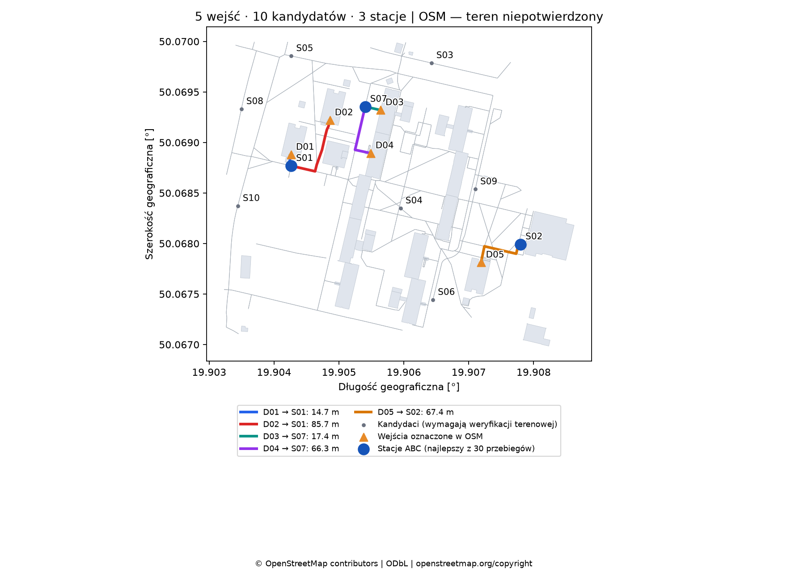
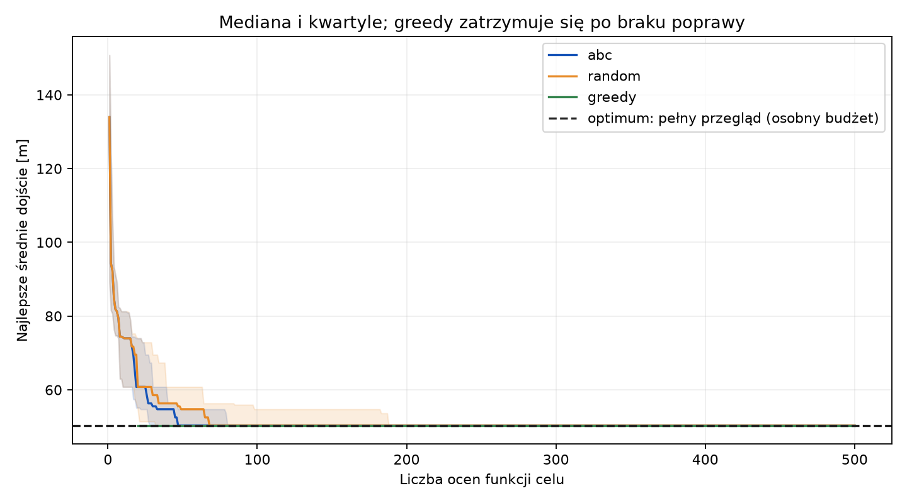

# AGH — demonstrator 5 wejść / 10 kandydatów / 3 stacje

**Weryfikacja mapowa. Kontrola terenowa odroczona; wszystkie 15 miejsc oraz trasy wymagają potwierdzenia w terenie.** Wagi popytu są jednakowe i założone.

| Metoda | Przebiegi | Średnie dojście [m] | Najlepszy wynik [m] | Oceny |
|---|---:|---:|---:|---:|
| abc | 30 | 50.291 | 50.291 | 500–500 |
| greedy | 1 | 50.291 | 50.291 | 48–48 |
| random | 30 | 50.291 | 50.291 | 500–500 |
| exact | 1 | 50.291 | 50.291 | 120–120 |

Greedy obejmuje zamiany 1-swap. Pełny przegląd ma osobny budżet 120 kombinacji.
To mała instancja kontrolna: zgodne wyniki metod potwierdzają działanie pipeline’u, a nie przewagę któregoś algorytmu.

## Pięć tras najlepszego układu ABC

| Wejście | Stacja | Długość [m] |
|---|---|---:|
| D01 — DS Olimp | S01 | 14.69 |
| D02 — DS Babilon | S01 | 85.74 |
| D03 — DS Filutek | S07 | 17.36 |
| D04 — DS Strumyk | S07 | 66.28 |
| D05 — DS Kapitol | S02 | 67.38 |

Każda linia składa się z zapisanych krawędzi OSM; nie dodano łączników od środka budynku. Pełne sekwencje i długości są w `routes.geojson`.

## Źródła i kontrola miejsc

Wersja danych OSM pochodzi z 29.10.2026; identyfikatory i hashe są w `dataset/manifest.json`. Wykaz AGH potwierdza tożsamość akademików, a nie aktualną dostępność wejść.
Model obejmuje zapisany wycinek sieci; przejścia poza nim nie są uwzględniane. Zadaszenia `building=roof` nie są traktowane jak pełne ściany budynku; zachowujemy tylko istniejące pod nimi ścieżki OSM.

| Miejsce | Odnośnik do OSM | Uzasadnienie / status |
|---|---|---|
| D01 — DS Olimp | [wejście](https://www.openstreetmap.org/node/9788952915) | `entrance=main`, węzeł na obrysie i w grafie; teren: do sprawdzenia |
| D02 — DS Babilon | [wejście](https://www.openstreetmap.org/node/9788980525) | `entrance=main`, węzeł na obrysie i w grafie; teren: do sprawdzenia |
| D03 — DS Filutek | [wejście](https://www.openstreetmap.org/node/2520230210) | `entrance=main`, węzeł na obrysie i w grafie; teren: do sprawdzenia |
| D04 — DS Strumyk | [wejście](https://www.openstreetmap.org/node/2520230205) | `entrance=main`, węzeł na obrysie i w grafie; teren: do sprawdzenia |
| D05 — DS Kapitol | [wejście](https://www.openstreetmap.org/node/5365576847) | `entrance=main`, węzeł na obrysie i w grafie; teren: do sprawdzenia |
| S01 — Punkt 1 — okolice DS Olimp | [węzeł](https://www.openstreetmap.org/node/14093171586) | Propozycja na istniejącym ciągu pieszym w pobliżu DS Olimp; poza buforem 3 m budynków, bez tagu bariery. Miejsce i dostępność wymagają kontroli terenowej. |
| S02 — Punkt 2 — okolice DS Kapitol | [węzeł](https://www.openstreetmap.org/node/13752891124) | Propozycja na istniejącym ciągu pieszym w pobliżu DS Kapitol; poza buforem 3 m budynków, bez tagu bariery. Miejsce i dostępność wymagają kontroli terenowej. |
| S03 — Punkt 3 — okolice DS Filutek | [węzeł](https://www.openstreetmap.org/node/2550232807) | Propozycja na istniejącym ciągu pieszym w pobliżu DS Filutek; poza buforem 3 m budynków, bez tagu bariery. Miejsce i dostępność wymagają kontroli terenowej. |
| S04 — Punkt 4 — okolice DS Strumyk | [węzeł](https://www.openstreetmap.org/node/11911971545) | Propozycja na istniejącym ciągu pieszym w pobliżu DS Strumyk; poza buforem 3 m budynków, bez tagu bariery. Miejsce i dostępność wymagają kontroli terenowej. |
| S05 — Punkt 5 — okolice DS Babilon | [węzeł](https://www.openstreetmap.org/node/13520399705) | Propozycja na istniejącym ciągu pieszym w pobliżu DS Babilon; poza buforem 3 m budynków, bez tagu bariery. Miejsce i dostępność wymagają kontroli terenowej. |
| S06 — Punkt 6 — okolice DS Kapitol | [węzeł](https://www.openstreetmap.org/node/2134207664) | Propozycja na istniejącym ciągu pieszym w pobliżu DS Kapitol; poza buforem 3 m budynków, bez tagu bariery. Miejsce i dostępność wymagają kontroli terenowej. |
| S07 — Punkt 7 — okolice DS Filutek | [węzeł](https://www.openstreetmap.org/node/2520230211) | Propozycja na istniejącym ciągu pieszym w pobliżu DS Filutek; poza buforem 3 m budynków, bez tagu bariery. Miejsce i dostępność wymagają kontroli terenowej. |
| S08 — Punkt 8 — okolice DS Olimp | [węzeł](https://www.openstreetmap.org/node/13519840705) | Propozycja na istniejącym ciągu pieszym w pobliżu DS Olimp; poza buforem 3 m budynków, bez tagu bariery. Miejsce i dostępność wymagają kontroli terenowej. |
| S09 — Punkt 9 — okolice DS Kapitol | [węzeł](https://www.openstreetmap.org/node/258234457) | Propozycja na istniejącym ciągu pieszym w pobliżu DS Kapitol; poza buforem 3 m budynków, bez tagu bariery. Miejsce i dostępność wymagają kontroli terenowej. |
| S10 — Punkt 10 — okolice DS Olimp | [węzeł](https://www.openstreetmap.org/node/13520399934) | Propozycja na istniejącym ciągu pieszym w pobliżu DS Olimp; poza buforem 3 m budynków, bez tagu bariery. Miejsce i dostępność wymagają kontroli terenowej. |

Do notowania sprawdzeń skopiuj `field-review-template.csv` poza katalog wyników; szablon jest odtwarzany przy każdym uruchomieniu. Puste pola nie są potwierdzeniem. To propozycje miejsc, bez potwierdzonej dostępności przestrzeni i zgody na stację.

Dane © OpenStreetMap contributors, [ODbL 1.0](https://opendatacommons.org/licenses/odbl/1-0/). [Informacja OSM](https://www.openstreetmap.org/copyright).
