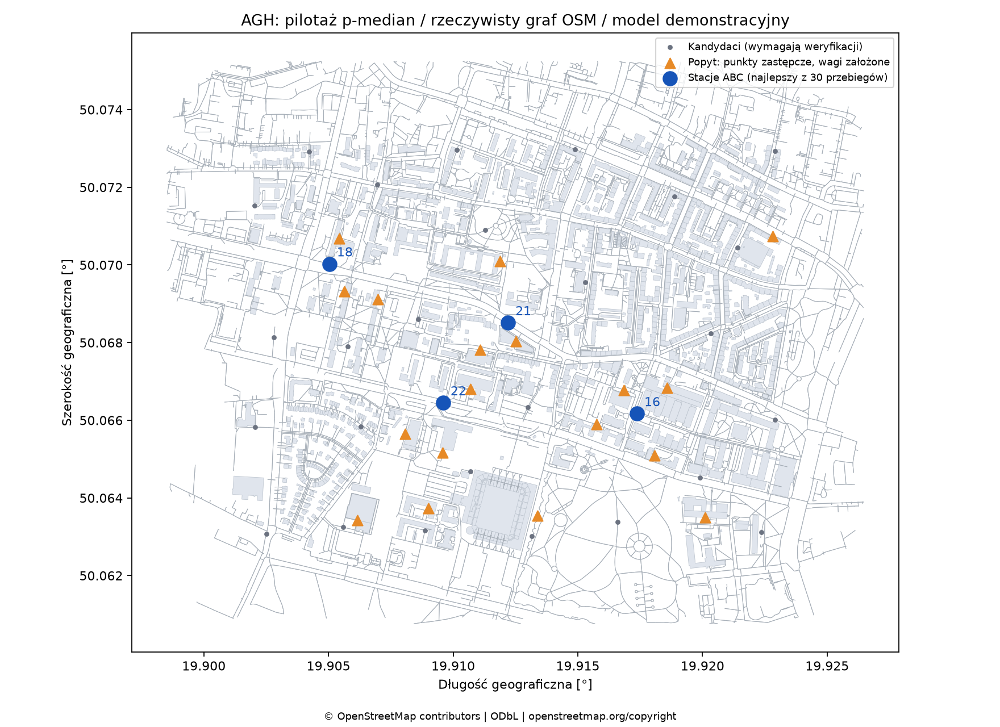
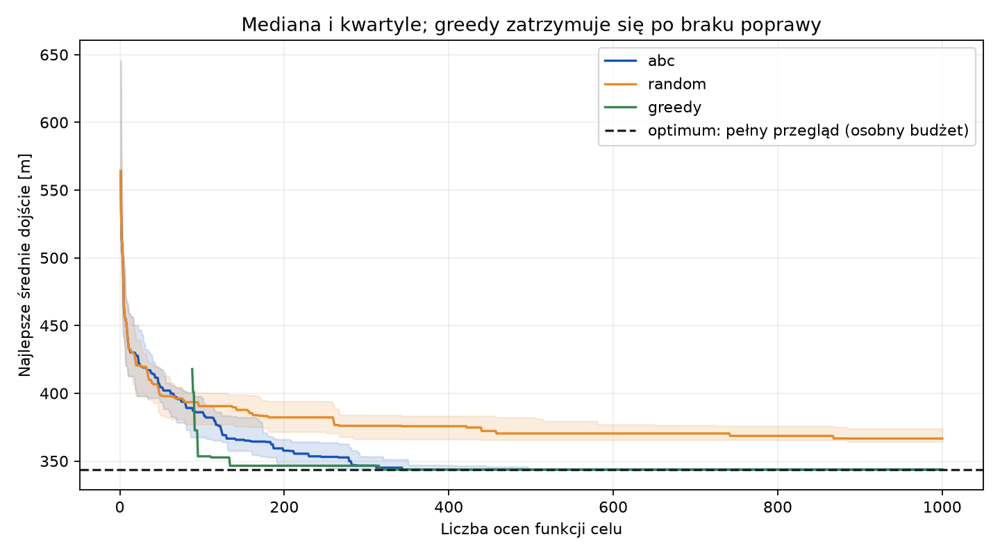

# Pierwszy model — zapis pilota z 29.10.2026

To gotowy materiał wyjściowy na spotkanie **9 listopada**. Obejmuje rzeczywistą sieć OSM oraz demonstracyjne punkty i wagi. Nie jest jeszcze rekomendacją fizycznych lokalizacji stacji.

## Instancja i porównanie

18 punktów popytu (po 6 w kategoriach dorm/teaching/other), 30 kandydatów, `p=4`, równa mieszanina 3 znormalizowanych scenariuszy. ABC: 12 źródeł, `limit=30`, budżet 1000 ocen; ABC i losowanie po 30 ziaren `0..29`. Metoda zachłanna obejmuje dodawanie i najlepsze zamiany 1-swap. Pełny przegląd sprawdza 27 405 kombinacji jako osobny wzorzec.

| Metoda | Liczba przebiegów | Najlepsze dojście [m] | Średnia [m] | Odch. std. [m] | Średnie pokrycie 250 m | Oceny na przebieg |
|---|---:|---:|---:|---:|---:|---:|
| ABC | 30 | 343,645 | 343,837 | 0,730 | 45,69% | 1000 |
| Losowanie | 30 | 346,523 | 366,791 | 10,464 | 36,25% | 1000 |
| Greedy + 1-swap | 1 | 343,645 | 343,645 | — | 45,83% | 426 |
| Pełny przegląd | 1 | 343,645 | 343,645 | — | 45,83% | 27 405 |

ABC osiąga optimum w **28 z 30** przebiegów, a jego średnia luka do optimum wynosi około **0,056%**. Najlepszy układ ABC to `candidate-16`, `candidate-18`, `candidate-21`, `candidate-22`. Greedy z zamianami także znajduje optimum, przy mniejszej liczbie ocen. W tej instancji **nie wykazaliśmy przewagi ABC nad silnym baseline’em**. Wynik względem losowania jest korzystny, ale jedna instancja i przyjęte wagi nie uzasadniają wniosku ogólnego.

Czasy są w [runs.csv](runs.csv) i [results.json](results.json); pochodzą z jednego komputera i nie są gwarancją czasu na innych urządzeniach. Cała ocena dotyczy małej, zastępczej instancji na grafie, a nie zmierzonego dostępu studentów do transportu.

## Mapa i zbieżność



Mapa przedstawia najlepszy układ jednego przebiegu ABC. Nie rysuje jeszcze tras od wejść; pełny zakres interaktywnego widoku jest w roadmapie.



Linie przedstawiają mediany, pasma zakres między kwartylami, a linia przerywana optimum. Greedy jest pojedynczym wynikiem deterministycznym; po zatrzymaniu jego wynik jest stały. [Historia poprawy](history.csv) przechowuje zdarzenia zmiany najlepszego wyniku z numerem oceny, bez powielania stałych odcinków.

## Stan jakości danych

- Surowy graf: 19 224 węzły; po filtrach i wyborze największej silnie spójnej składowej: 18 317 węzłów i 39 860 skierowanych krawędzi.
- Pobrano 1340 obrysów budynków. Jawne ograniczenia dostępu usunęły 48 węzłów i 202 krawędzie; pozostałe składowe są wyszczególnione w manifeście.
- W zachowanym grafie 1401 węzłów ma tag bariery wymagający przeglądu. Sam taki tag nie przesądza o zakazie ruchu pieszego.
- Każdy z 30 kandydatów wymaga audytu. Największe odsunięcie punktu popytu od punktu reprezentatywnego budynku wynosi 51,432 m i nie jest doliczane do celu.
- Wagi są założone. Dostęp od drzwi budynku, własność terenu, miejsce na stację i niektóre ograniczenia dostępu pozostają do sprawdzenia.

Dokładne źródło, czasy stanu bazy OSM i hashe zawiera [manifest](../../data/processed/agh-pilot/manifest.json). Odpowiedzi OSM zebrano w osobnych zapytaniach; nie jest to jedna transakcyjna migawka bazy. Dane: **© OpenStreetMap contributors**, [ODbL 1.0](https://opendatacommons.org/licenses/odbl/1-0/), [informacja OSM](https://www.openstreetmap.org/copyright).

## Odtworzenie

```sh
uv sync --locked --all-extras
uv run agh-stations benchmark --p 4 --budget 1000 --runs 30 --exact --output outputs/reproduced
uv run agh-stations report --results outputs/reproduced
```

`results.json` zapisuje hash `problem.json`, wersje i parametry. W zamrożonym środowisku oczekujemy tych samych wyborów i wartości celu; czasy mogą się zmieniać. W raporcie końcowym trzeba zastąpić pilota audytowanymi danymi i wykonać protokół z [EXPERIMENTS.md](../../docs/EXPERIMENTS.md).
